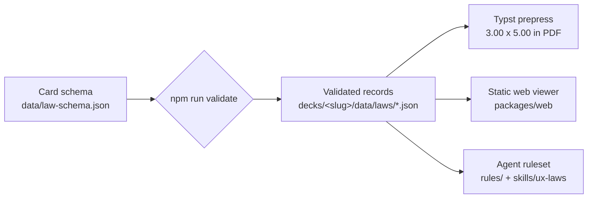

<div align="center">
    
    <h1>Knowledge Domain Decks</h1>
    <p><strong>One dataset. Print, phone, and agent output.</strong></p>
    <p><em>An open-source reference card deck for UX and behavioral design, where every card is a validated record and every artifact is generated from it.</em></p>
    <p>
        <a href="./LICENSE"></a>
        <a href="./LICENSE-DATA"></a>
        
        
    </p>
</div>

---

## 📖 Table of Contents

- [🤔 What is this?](#-what-is-this)
- [🃏 The First Deck](#-the-first-deck)
- [🎴 How to Use It](#-how-to-use-it)
- [🧩 Card Anatomy](#-card-anatomy)
- [🗂️ Repository Layout](#️-repository-layout)
- [🛠️ Developer Setup & Verification](#️-developer-setup--verification)
- [📄 Citation & License](#-citation--license)

---

## 🤔 What is this?

**Knowledge Domain Decks** turns a body of professional knowledge into reference
cards that a person can hold, a phone can show, and a coding agent can apply.
The first deck covers UX and behavioral design: fifty-four principles, each distilled
into the smallest usable form — an axiom, a trigger, a checklist, an
anti-pattern, a generated diagram, and one exact academic source.

The point is not the PDF, the web page, or the skill file. The point is that
all three come from the same validated records:



Every output is generated. Nothing is hand-edited downstream: fix a typo in a
card record, rerun the generators, and the PDF, the viewer bundle, and the rules
all move together.

The ruleset, the skill, the viewer bundle, and the PDF all regenerate
byte-identically, so the same records produce the same bytes on the same Typst
version and font environment; [`DECISIONS.md`](./DECISIONS.md) §29 records what
that leaves open. The print build pins `SOURCE_DATE_EPOCH`, the
reproducible-builds convention, to
2026-11-09T00:00:00Z: Typst reads it for `/ModDate` and derives the trailer `/ID`
from it, so two builds of one commit are identical rather than differing by the
stamp. An inherited `SOURCE_DATE_EPOCH` overrides the pin, so a distributor can
stamp their own. The date is fixed rather than taken from the commit because an
exported tree has no git history, and a tarball build has to produce the same
bytes as a checkout build.

The deck is deliberately clean-room. The wording is written for this project,
the diagrams are drawn parametrically from each card's `graphicMetaphor` data,
and no other deck's copy, names, or trade dress is used.

---

## 🃏 The First Deck

**UX & Behavioral Design** is a fifty-four-card deck: every category is complete,
and eleven of the fifty-four are decision-making. It proves the whole pipeline end
to end and is useful as it stands.

Every one of the **54 principles** in the project's research list now has a
card. That list is longer than the 52-item taxonomy in the project's
architecture notes: where the two differ, the longer list wins, and each
difference is recorded in [`DECISIONS.md`](./DECISIONS.md).

Each card cites one primary paper, with that paper's own authors, year, title,
and venue:

| ID | Card | Category | Primary source |
|---|---|---|---|
| HMM-01 | **Jakob's Law** | Heuristic & Mental Models | Nielsen (2000), *Designing Web Usability* |
| HMM-02 | **Mental Model Theory** | Heuristic & Mental Models | Craik (1943), *The Nature of Explanation* |
| HMM-03 | **Conceptual Integrity** | Heuristic & Mental Models | Brooks (1975), *The Mythical Man-Month* |
| HMM-04 | **Aesthetic-Usability Effect** | Heuristic & Mental Models | Kurosu & Kashimura (1995), *Apparent usability vs. inherent usability* |
| HMM-05 | **Principle of Least Astonishment (POLA)** | Heuristic & Mental Models | Cowlishaw (1984), *The design of the REXX language* |
| HMM-06 | **Postel's Law (Robustness Principle)** | Heuristic & Mental Models | Postel (1980), *DoD standard Transmission Control Protocol* (RFC 761) |
| HMM-07 | **Occam's Razor (Principle of Parsimony)** | Heuristic & Mental Models | Maeda (2006), *The Laws of Simplicity* |
| HMM-08 | **Conway's Law** | Heuristic & Mental Models | Conway (1968), *How Do Committees Invent?* |
| HMM-09 | **Gulf of Execution and Gulf of Evaluation** | Heuristic & Mental Models | Norman (1986), *Cognitive Engineering* |
| HMM-10 | **Affordance Theory** | Heuristic & Mental Models | Gibson (1977), *The Theory of Affordances* |
| HMM-11 | **Feedback Principle (Cybernetic Loop)** | Heuristic & Mental Models | Wiener (1948), *Cybernetics: Or Control and Communication in the Animal and the Machine* |
| GES-01 | **Law of Proximity** | Gestalt & Visual Perception | Wertheimer (1923), *Untersuchungen zur Lehre von der Gestalt II* |
| GES-02 | **Law of Similarity** | Gestalt & Visual Perception | Wertheimer (1923), *Untersuchungen zur Lehre von der Gestalt II* |
| GES-03 | **Law of Common Region** | Gestalt & Visual Perception | Palmer (1992), *Common region: A new principle of perceptual grouping* |
| GES-04 | **Law of Prägnanz (Law of Simplicity / Good Figure)** | Gestalt & Visual Perception | Wertheimer (1923), *Untersuchungen zur Lehre von der Gestalt II* |
| GES-05 | **Law of Closure** | Gestalt & Visual Perception | Koffka (1935), *Principles of Gestalt Psychology* |
| GES-06 | **Law of Figure/Ground** | Gestalt & Visual Perception | Rubin (1915), *Synsoplevede Figurer* |
| GES-07 | **Law of Continuity (Good Continuation)** | Gestalt & Visual Perception | Wertheimer (1923), *Untersuchungen zur Lehre von der Gestalt II* |
| GES-08 | **Law of Uniform Connectedness** | Gestalt & Visual Perception | Palmer & Rock (1994), *Rethinking perceptual organization: The role of uniform connectedness* |
| GES-09 | **Law of Common Fate** | Gestalt & Visual Perception | Wertheimer (1923), *Untersuchungen zur Lehre von der Gestalt II* |
| GES-10 | **Law of Focal Point** | Gestalt & Visual Perception | Palmer (1999), *Vision Science: Photons to Phenomenology* |
| GES-11 | **Law of Past Experience** | Gestalt & Visual Perception | Koffka (1935), *Principles of Gestalt Psychology* |
| DEC-01 | **Hick's Law** | Decision-Making & Cognitive Load | Hick (1952), *On the Rate of Gain of Information* |
| DEC-02 | **Miller's Law** | Decision-Making & Cognitive Load | Miller (1956), *The Magical Number Seven, Plus or Minus Two* |
| DEC-03 | **Tesler's Law** | Decision-Making & Cognitive Load | Saffer (2007), *Designing for Interaction*, first edition |
| DEC-04 | **Choice Overload** | Decision-Making & Cognitive Load | Iyengar & Lepper (2000), *When Choice Is Demotivating* |
| DEC-05 | **Cognitive Load Theory** | Decision-Making & Cognitive Load | Sweller (1988), *Cognitive Load During Problem Solving* |
| DEC-06 | **Working Memory Capacity Model** | Decision-Making & Cognitive Load | Cowan (2001), *The Magical Number 4 in Short-Term Memory* |
| DEC-07 | **Cognitive Friction** | Decision-Making & Cognitive Load | Cooper (1999), *The Inmates Are Running the Asylum* |
| DEC-08 | **Framing Effect** | Decision-Making & Cognitive Load | Tversky & Kahneman (1981), *The Framing of Decisions and the Psychology of Choice* |
| DEC-09 | **Simon's Bounded Rationality and Satisficing** | Decision-Making & Cognitive Load | Simon (1956), *Rational Choice and the Structure of the Environment* |
| DEC-10 | **Cognitive Absorption** | Decision-Making & Cognitive Load | Agarwal & Karahanna (2000), *Time Flies When You're Having Fun* |
| DEC-11 | **Decision Fatigue** | Decision-Making & Cognitive Load | Baumeister et al. (1998), *Ego Depletion: Is the Active Self a Limited Resource?* |
| TME-01 | **Fitts's Law** | Time, Motion & Ergonomics | Fitts (1954), *The Information Capacity of the Human Motor System* |
| TME-02 | **Accot-Zhai Steering Law** | Time, Motion & Ergonomics | Accot & Zhai (1997), *Beyond Fitts' Law: Models for Trajectory-Based HCI Tasks* |
| TME-03 | **Doherty Threshold** | Time, Motion & Ergonomics | Doherty & Thadhani (1982), *The Economic Value of Rapid Response Time* |
| TME-04 | **Perceived Performance Heuristics** | Time, Motion & Ergonomics | Seow (2008), *Designing and Engineering Time* |
| TME-05 | **Power Law of Practice** | Time, Motion & Ergonomics | Newell & Rosenbloom (1981), *Mechanisms of Skill Acquisition and the Law of Practice* |
| TME-06 | **Keystroke-Level Model** | Time, Motion & Ergonomics | Card, Moran & Newell (1980), *The Keystroke-Level Model for User Performance Time with Interactive Systems* |
| TME-07 | **Weber-Fechner JND Law** | Time, Motion & Ergonomics | Weber (1834), *De Pulsu, Resorptione, Auditu et Tactu* |
| TME-08 | **Gilbreth Motion Economy** | Time, Motion & Ergonomics | Gilbreth (1911), *Motion Study* |
| TME-09 | **Crossman's Velocity Law (Welford's Variant)** | Time, Motion & Ergonomics | Welford (1968), *Fundamentals of Skill* |
| TME-10 | **Visual Saccadic Latency Law** | Time, Motion & Ergonomics | Dodge (1900), *Visual Perception During Eye Movement* |
| MPA-01 | **Serial Position Effect** | Memory, Perception & Attention | Murdock (1962), *The Serial Position Effect of Free Recall* |
| MPA-02 | **Von Restorff Effect (Isolation Effect)** | Memory, Perception & Attention | von Restorff (1933), *Über die Wirkung von Bereichsbildungen im Spurenfeld* |
| MPA-03 | **Zeigarnik Effect** | Memory, Perception & Attention | Zeigarnik (1927), *Über das Behalten von erledigten und unerledigten Handlungen* |
| MPA-04 | **Peak-End Rule** | Memory, Perception & Attention | Kahneman et al. (1993), *When More Pain Is Preferred to Less* |
| MPA-05 | **Anchoring Bias** | Memory, Perception & Attention | Tversky & Kahneman (1974), *Judgment under Uncertainty: Heuristics and Biases* |
| MPA-06 | **Selective Attention and Attentional Bottleneck** | Memory, Perception & Attention | Broadbent (1958), *Perception and Communication* |
| MPA-07 | **Confirmation Bias** | Memory, Perception & Attention | Nickerson (1998), *Confirmation Bias: A Ubiquitous Phenomenon in Many Guises* |
| MPA-08 | **Sunk Cost Fallacy** | Memory, Perception & Attention | Arkes & Blumer (1985), *The Psychology of Sunk Cost* |
| MPA-09 | **Loss Aversion** | Memory, Perception & Attention | Kahneman & Tversky (1979), *Prospect Theory: An Analysis of Decision under Risk* |
| MPA-10 | **Goal-Gradient Effect** | Memory, Perception & Attention | Kivetz, Urminsky & Zheng (2006), *The Goal-Gradient Hypothesis Resurrected* |
| MPA-11 | **Status Quo Bias** | Memory, Perception & Attention | Samuelson & Zeckhauser (1988), *Status Quo Bias in Decision Making* |

That table follows the taxonomy's category order. The PDF and the viewer print
cards in ID order - `DEC`, `GES`, `HMM`, `MPA`, `TME` - so the two sequences are
different and neither is a mistake.

The categories are part of the schema, so every later card lands in one of
them and the filters, accents, and rules sections follow automatically:

| Category | Cards | What it audits |
|---|---|---|
| Heuristic & Mental Models | HMM-01 to HMM-11 | Whether the interface matches what people already know |
| Gestalt & Visual Perception | GES-01 to GES-11 | Grouping, spacing, and perceived structure |
| Decision-Making & Cognitive Load | DEC-01 to DEC-11 | Option count, comparison effort, working memory, decision quality over time |
| Time, Motion & Ergonomics | TME-01 to TME-10 | Target size, distance, motor effort, practice, operator time, perceptual ratio, motion economy, and saccade timing |
| Memory, Perception & Attention | MPA-01 to MPA-11 | Position, distinctiveness, unfinished tasks, remembered peaks, anchor values, selective attention, confirmation, sunk costs, loss asymmetry, goal proximity, and defaults |

---

## 🎴 How to Use It

### Web: open the file

Open [`packages/web/index.html`](./packages/web/index.html) in any modern
browser. Double-clicking the file works: a generated classic script carries the
card data, so nothing needs a server, a bundler, or a network connection.

- Tap or click a card, or press **Enter** / **Space**, to flip between the
  principle and its operational checklist.
- Filter by category with the pills above the deck.
- The layout is built for a 390 px phone viewport and has no horizontal scroll.

<div align="center">
    
</div>

### Print: build the PDF

The print layer is a Typst template that renders one card per page, recto and
verso, at Tarot proportions: a 3.00 x 5.00 in page holding a 2.75 x 4.75 in trim
plus 0.125 in bleed, with corner trim marks.

```bash
npm run build:pdf
```

The output is `packages/prepress/dist/ux-laws.pdf`. This step requires
[Typst](https://typst.app/) on `PATH`; the build script checks for it and exits
with an install message rather than substituting another renderer.

**What has been checked in the built PDF.** With Typst 0.15.1, `npm run
build:pdf` emits a 108-page file of 1,072,772 bytes (1,047 KiB), and two
consecutive builds of one commit are byte-identical. `npm run check:pdf`
measured a 216 x 360 pt MediaBox on every page. On the rendered pages, trim
ticks sit in the bleed band at all four trim corners of every page; every run of
body text is 6.5 pt or larger, with the Source line read back at 6.5 pt on all
fifty-four versos and absent from the rectos. The labels drawn inside the
diagrams are smaller by design: figure labels print at 2.59 to 3.24 pt, the
smallest at 8 units, so the figures are annotations rather than type, and each
one was inspected on its own card at 400 ppi. Every recto's lowest ink was measured against the
bottom safe edge — the internal margin, 0.1875 in inside the trim line, so
0.3125 in from the paper edge — as the lowest vector outline inside the page
frame; the tightest card clears it by 7.32 pt. The topmost ink on every recto stands 0.08 pt above
the top safe edge, a constant of the template rather than a card's line running
long, and about 8 pt of paper remains before the trim. Every diagram is drawn as form XObjects with ink measured
on its own card, so it is real vector geometry rather than a raster image or an
empty placeholder.

### Agents: load the ruleset

The same deck reaches an agent's working context two ways:

- [`skills/ux-laws/SKILL.md`](./skills/ux-laws/SKILL.md) — the skill, and an
  index. It carries the frontmatter, the rules that hold everywhere, and a
  table per category of ID, name and the card's own trigger sentence. The card
  bodies live in [`skills/ux-laws/resources/`](./skills/ux-laws/resources/),
  one file per category, read on demand. Copy the whole `ux-laws/` directory
  into an agent's skills directory; the index points at the resource files
  beside it.
- [`rules/ux-rules.md`](./rules/ux-rules.md) — every card in one plain ruleset,
  for pasting into a review prompt or project instructions.

All are generated from the deck's `data/laws/*.json` by `npm run build:rules`. Edit the
records, not the generated files. The split is deliberate: the index is about
6 KB and the largest resource file about 10 KB, where the single skill file was
28 KB loaded whole before the agent read any code. [`DECISIONS.md`](./DECISIONS.md)
§35 records what the split costs.

---

## 🧩 Card Anatomy

Every card is one JSON object with nine fields. The schema rejects unknown
fields, so a record cannot quietly grow a second source of truth:

| Field | What it holds |
|---|---|
| `id` | Category prefix and two-digit sequence, e.g. `DEC-01` |
| `name` | The principle's common name, 50 characters or fewer |
| `category` | One of the five fixed categories |
| `axiom` | The core claim, at most 15 words |
| `trigger` | The observable symptom that means "check this card" |
| `checklist` | Three or four actions, each with a `text` and a `kind`: `code` when reading code can check or act on it, `research` when it needs an experiment or a recorded run |
| `antiPattern` | A `violation` and its `remediation`, as one pair |
| `graphicMetaphor` | An `svgShape` plus the parameters that draw it |
| `academicOrigin` | One primary source: authors, year, title, venue, optional DOI |

The validator enforces the limits the schema alone cannot: the axiom must be
both 110 characters or fewer and 15 words or fewer, because a character cap
does not bound a printed line and a word count does not bound glyph width.
Checklist items cap at 120 characters, IDs must match `^[A-Z]{3}-[0-9]{2}$`,
and duplicate IDs fail the run.

---

## 🗂️ Repository Layout

```
.
├── decks/                       # One directory per deck; nothing else names a deck
│   ├── ux-laws/                 # UX & Behavioral Design
│   │   ├── deck.json            # id, slug, title, categories, accents, output paths, prose
│   │   └── data/
│   │       ├── law-schema.json  # Canonical JSON Schema (draft 2020-12)
│   │       └── laws/*.json      # One validated record per card
│   └── narrative/               # Narrative Architecture (same layout; its own schema,
│                                #   field mapping and families)
├── packages/
│   ├── core/                    # The engine: deck loading, schema, SVG shapes
│   │   ├── deck.mjs
│   │   └── svg.js               # Parametric SVG generator
│   ├── prepress/                # Typst template + PDF build (deck-neutral)
│   │   ├── src/card.typ
│   │   └── build.mjs
│   ├── web/                     # Static viewer shell
│   │   ├── index.template.html
│   │   ├── styles.css
│   │   ├── app.js
│   │   └── decks/<slug>/        # Generated per deck: deck-data.js, accents.js, index.html
│   ├── rules/                   # Ruleset generator (reads any deck)
│   ├── judges/                  # Cross-model audit panel (needs a model endpoint)
│   └── triage/                  # Adjudication: turns claims into checked verdicts
├── rules/<slug>-rules.md        # Generated agent ruleset, one per deck
├── skills/<slug>/
│   ├── SKILL.md                 # Generated skill index
│   └── resources/*.md           # Generated card bodies, one file per category
├── scripts/
│   ├── validate.mjs             # Schema + cross-record checks
│   ├── generate-web-data.mjs    # Builds packages/web/decks/<slug>/
│   ├── check-web.mjs            # Headless 390 px viewer smoke test, one page per deck
│   └── pdf-check.mjs            # Page-box and page-count check
├── media/
│   ├── icons/                   # Transparent WebP icon set (1024 master, web sizes)
│   └── card-viewer-390.png      # README screenshot
├── DECISIONS.md                 # Deviations from the source specs and why
├── CHANGELOG.md
├── LICENSE                      # MIT (code)
└── LICENSE-DATA                 # CC0-1.0 (data and schema)
```

Everything a deck says about itself lives in its `deck.json`: the category
order, every title and paragraph the generators print, the skill name, the
category accents, and where its artifacts go. The engine reads those; nothing
in `packages/` names a deck, which is what lets `decks/` hold a second one.

### Adding a deck

1. `mkdir -p decks/<slug>/data/laws` and write `decks/<slug>/deck.json` — the
   fields are the ones `decks/ux-laws/deck.json` shows, and a deck with no
   accents simply falls back to a neutral colour on every card.
2. Put a JSON Schema at `decks/<slug>/data/law-schema.json` and one record per
   card in `data/laws/`. The enum on the schema's group field is overridden by
   the deck's own category list at validation time, so the two cannot disagree.
   A deck whose records are shaped differently declares that in `deck.json`:
   `fields` maps the group, ordered items, attribution, figure and optional
   prompt onto its own key names, `labels` names the list on the card face and
   in the generated markdown, and `itemStyle` chooses ticking boxes or numbered
   beats. `printOrder` chooses the order the deck is read in: `"id"` (the
   default) or `"family"`, which follows the category list above. A deck that
   declares none of these gets the first deck's shape and order.
3. Build and check:

   ```bash
   npm run validate -- --deck <slug>
   npm run build -- --deck <slug>       # web bundle, rules, skill, PDF
   npm run check:web -- --deck <slug>
   npm run check:pdf -- --deck <slug>
   ```

4. Nothing else. If a step needs an edit under `packages/`, the engine is not
   deck-agnostic for that deck and the edit belongs in `packages/core/`, not in
   the deck. `scripts/test/invented-deck.test.mjs` is that rule as a test: it
   builds a deck invented inside the test, never committed, through this whole
   pipeline.

Every command takes `--deck <slug>`; with no flag it runs over every deck in
`decks/`, in sorted order. `npm run accept` gates whatever is committed.
```

---

## 🛠️ Developer Setup & Verification

### Requirements

- **Node.js 22+** — the scripts use the built-in `fetch` and `WebSocket`.
- **Chrome or Chromium** — only for `npm run check:web` (set `CHROME_PATH` if it
  is not in a standard location).
- **Typst** — only for `npm run build:pdf` and `npm run check:pdf`.

### Commands

```bash
# 1. Install the single dev dependency (Ajv)
npm install

# 2. Validate every record against the schema
npm run validate

# 3. Regenerate the derived artifacts
npm run build:web       # packages/web/decks/<slug>/{deck-data.js,accents.js,index.html}
npm run build:rules     # rules/ux-rules.md, skills/ux-laws/SKILL.md and resources/

# 4. Print layer (requires Typst)
npm run build:pdf       # packages/prepress/dist/<slug>.pdf
npm run check:pdf       # every MediaBox is 216 x 360 pt, page count matches

# 5. Checks
npm run check:web       # headless 390 px smoke test (Chrome/Chromium)
npm run check:all       # validate + regenerate rules and web data + web smoke test
npm run check           # validate + regenerate, without the browser step

# 6. Tests — the same commands, plus the facts they cannot see
npm test                # every suite below, in one run
npm run test:unit       # deck facts, validator, generators, SVG geometry (no browser, no Typst)
npm run test:integration  # the pipeline end to end, then the gate on HEAD

# 7. Verify a specific commit, in a worktree nobody else is using
npm run accept          # HEAD
npm run accept -- <ref> # any commit-ish

# 8. Audit an artifact with a panel of models (optional; needs a local endpoint)
npm run judge -- --panel packages/judges/panels/deck-skill.json \
                  --artifact skills/ux-laws/SKILL.md
npm run test:judges     # offline tests for the panel runner

# 9. Record what you found when you checked the findings
npm run triage -- --report .judges/<run>/report.json --template > audit/adjudication.json
npm run triage -- --report .judges/<run>/report.json \
                  --adjudications audit/adjudication.json
npm run test:triage     # offline tests for the adjudication join
```

`npm test` is the whole of it: it is what CI runs, and there is no CI-only
script or configuration. It covers the deck's own facts (54 records, deck
order, the two citation strings), the validator as a program — including the
duplicate-ID rule the gate does not reach — the generators' byte stability and
which artifacts each year reaches, the geometry of the two shapes whose
drawing has been wrong before, every pipeline step in one order, and finally
`npm run accept` against HEAD in a worktree of its own.

A stage that cannot run is reported as skipped with its reason, never dropped.
`test:unit` needs no browser and no Typst; `test:integration` skips its PDF
steps when Typst is absent and its browser step when Chrome is absent, so a
machine without them gets fewer proofs and is told so. When `CI` is set, a skip
becomes a failure instead: the workflow installs those tools on purpose, so
there a skip can only mean the installation broke and the run is green on less
than it claims.

The judge panel and triage are development tools, not build steps. The panel
writes to `.judges/`, which is not committed, and it never decides anything on
its own: a finding is a claim until someone checks it at the source. An
adjudication is the checked record, keyed to the artifact's hash; `triage`
prints what has no verdict yet and refuses to apply an adjudication written
against different bytes. See [`packages/judges/README.md`](./packages/judges/README.md)
and [`packages/triage/README.md`](./packages/triage/README.md).

### Continuous integration

`.github/workflows/ci.yml` runs on every push to any branch, every pull request,
and on demand — so a branch proves the workflow before `main` inherits it. It
does three things before testing: checks out with full history
(the gate reads the log to judge commit hygiene), installs Node 22, and installs
**Typst 0.15.1** — pinned, then verified, because a different Typst may print
the same deck with different page boxes and "some typst" is not the dependency
this repository means. It then pins `CHROME_PATH` to the runner's Chrome, which
turns `check:web`'s "no browser, skip" exit code into a failed install instead of
a silent skip, and runs `npm ci` and `npm test`.

What stays manual, on any machine:

| Not in CI | Why |
|---|---|
| `print: contents` | Whether trim marks land on paper, type reads at 3×5 in, and the figures survive print is a judgement from looking at rendered pages. The gate reports it NOT RUN, and CI inherits that. |
| `npm run judge`, `npm run triage` | These need a model endpoint and a human adjudicating each finding. They are development tools, not build steps. |
| Publishing the PDF and the site | A green run is evidence about a commit, not permission to publish it. |

### Hooks: the same checks, before the commit leaves the machine

`.githooks/` holds two hooks. `pre-commit` runs `test:unit` — under a second, no
browser and no Typst, cheap enough that nobody is tempted to skip it on a normal
day. `pre-push` runs `npm test`, the whole suite including the acceptance gate,
because a pre-commit hook cannot see a rebase or an amend: it runs before those
exist, so a commit that was green when written can still reach a push red.
pre-push runs on the commits actually leaving the machine.

Git does not clone hooks, so each clone opts in once:

```
npm run hooks:install    # git config core.hooksPath .githooks
```

The bypass is deliberate and visible: `git commit --no-verify`, `git push
--no-verify`. A local hook protects this machine; it cannot protect a clone that
never ran the installer, a push from another machine, or a ref update made by a
web editor. CI is the backstop for all three, and it reports rather than blocks
— the workflow runs after the push. Hooks and CI check the same commands; there
is no hook-only path, so a hook that passes and a workflow that passes mean the
same thing.

### What the checks prove

| Command | Proves |
|---|---|
| `npm run validate` | Every record satisfies the schema, axiom length and word limits hold, IDs are unique |
| `npm run build:web` | Each deck's viewer bundle regenerates from its own `data/laws/` |
| `npm run build:rules` | The ruleset and skill regenerate from the same records |
| `npm run check:web` | At 390 px: no horizontal overflow, every record renders as a card, flip exposes the verso, and a category filter shows exactly that category's cards — the counts are read from the deck's `data/laws/`, not hardcoded |
| `npm run check:pdf` | Every page's MediaBox is 216 x 360 pt and the page count is twice the card count |
| `npm run accept` | That one commit, not the working tree: commit hygiene, schema and its rejection of known-bad fixtures, generator agreement, the SVG contract, and the web smoke test - run in a detached worktree of that commit |
| `npm test` | All of the above, plus what they cannot see: the deck's record counts and order, the validator's duplicate-ID rule, generator byte stability outside a worktree, the geometry of the two shapes that have drawn wrong before, and the pipeline in one order before the gate runs on HEAD |

Last full run: **2026-11-10**, macOS, Node 22.23.4, Chrome 157, Typst 0.15.1 —
`npm test` exits 0 with 62 tests and 0 skipped, and the gate it ends with reports
13 passed, 0 failed, 1 not run. `npm run check:all` exits 0 and the PDF builds.

Two honest limits. `npm run check:pdf` proves page geometry only. Whether the
marks land on paper and whether the type reads comfortably at print size are
judgements from looking at rendered pages, not something the check asserts.
And `npm run accept` reports NOT RUN for anything it could not execute - a
browser or Typst it could not find, or a check no tool can make, such as whether
the marks land on paper - so a layer it could not check stays unproven rather
than passing, and it exits 3 when nothing at all could be verified.

---

## 📄 Citation & License

If you reference Knowledge Domain Decks in research, teaching, or software,
please cite:

```bibtex
@software{Mustard_Knowledge_Domain_Decks_2026,
  author = {Mustard, Thomas J. L.},
  title = {{Knowledge Domain Decks}},
  year = {2026},
  url = {https://github.com/tjmustard/knowledge-domain-decks-skills}
}
```

Code is distributed under the **MIT License**; see [`LICENSE`](./LICENSE).
Card data and the JSON Schema are dedicated to the public domain under
**CC0-1.0**; see [`LICENSE-DATA`](./LICENSE-DATA).

The research notes under `SupportingInformation/` are read-only inputs whose
provenance and licensing are separate from this repository. They are excluded
from git; the knowledge they carry reaches the deck through the CC0 dataset and
the citations printed on each card.
