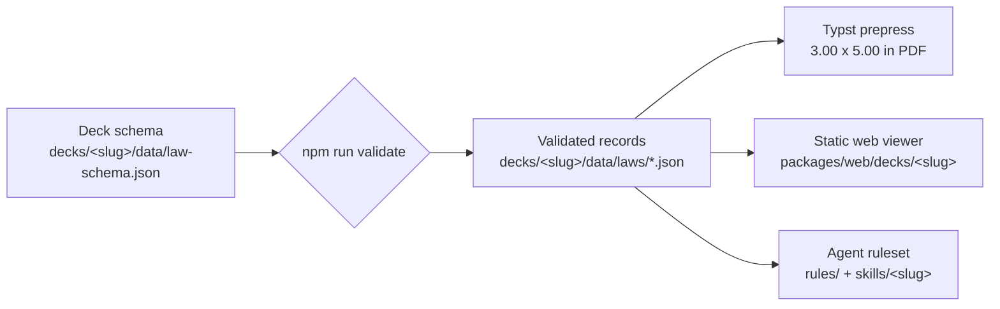

<div align="center">
    
    <h1>Knowledge Domain Decks</h1>
    <p><strong>One dataset. Print, phone, and agent output.</strong></p>
    <p><em>An open-source platform for reference card decks, where every card is a validated record and every artifact is generated from it.</em></p>
    <p>
        <a href="./LICENSE"></a>
        <a href="./LICENSE-DATA"></a>
        
        
    </p>
</div>

---

## 📖 Table of Contents

- [🤔 What is this?](#-what-is-this)
- [🃏 The Decks](#-the-decks)
- [🧭 UX & Behavioral Design](#-ux--behavioral-design)
- [📖 Narrative Architecture](#-narrative-architecture)
- [🎭 Archetypal Architecture](#-archetypal-architecture)
- [🗣️ Facilitation Architecture](#️-facilitation-architecture)
- [🔁 Retrospective Architecture](#-retrospective-architecture)
- [🎯 Strategy Architecture](#-strategy-architecture)
- [👥 Team Architecture](#-team-architecture)
- [🧪 Innovation Architecture](#-innovation-architecture)
- [💡 Ideation Architecture](#-ideation-architecture)
- [✍️ Copy Architecture](#️-copy-architecture)
- [⏳ Productivity Architecture](#-productivity-architecture)
- [🏷️ Brand Architecture](#-brand-architecture)
- [🤝 Negotiation Architecture](#-negotiation-architecture)
- [🎴 How to Use It](#-how-to-use-it)
- [🧩 Card Anatomy](#-card-anatomy)
- [🗂️ Repository Layout](#️-repository-layout)
- [🛠️ Developer Setup & Verification](#️-developer-setup--verification)
- [📄 Citation & License](#-citation--license)

---

## 🤔 What is this?

**Knowledge Domain Decks** turns a body of professional knowledge into reference
cards that a person can hold, a phone can show, and a coding agent can apply.
A deck is a set of validated card records; the pipeline turns those records into
a printed PDF, a static web viewer, and an agent ruleset plus skill, with no
hand-edited output anywhere.

Twelve decks ship today. **UX & Behavioral Design** covers fifty-four principles of
interface and cognitive design. **Narrative Architecture** covers forty-eight
story-structure patterns for turning a change into something an audience can
follow. **Archetypal Architecture** covers sixteen voices a team can speak in.
**Facilitation Architecture** covers forty-eight exercises for running a session.
**Retrospective Architecture** covers forty-five rituals for a team looking at
its own work. **Strategy Architecture** covers forty-two frameworks for a
leadership team deciding where to compete and why a lead survives. **Team
Architecture** covers forty-four team and leadership frameworks, each carried as
the script a manager says when the team is stuck. **Innovation Architecture**
covers forty-two product-discovery and experimentation tactics, each carried as
an hypothesis and the threshold that would prove it. **Ideation Architecture**
covers fifty idea-generation tactics, each carried as a five-minute sprint you
can run. **Copy Architecture** covers forty-eight copy formulas, each carried
as the proportions it allocates and the template it fills. **Productivity
Architecture** covers forty-four working tactics, each carried as the friction
it resolves and the numbered procedure that follows it. **Brand Architecture**
covers forty-two brand frameworks, each carried as the alignment question that
says it applies, the artifact it produces, and the anti-pattern that turns it
into decoration. **Negotiation Architecture** covers forty-four bargaining
moves, each carried as the source's scenario, the script a negotiator says, and
the counter-move that answers the other side's defense. Each card is distilled into the smallest usable form: a claim, a
trigger, a procedure, an anti-pattern, a generated diagram, and one exact source.

The point is not the PDF, the web page, or the skill file. The point is that
all of them come from the same validated records:



Every output is generated. Nothing is hand-edited downstream: fix a typo in a
card record, rerun the generators, and that deck's PDF, viewer bundle, and rules
all move together.

The ruleset, the skill, the viewer bundle, and the PDF all regenerate
byte-identically, so the same records produce the same bytes on the same Typst
version, with the diagram face vendored in the repository
([`DECISIONS.md`](./DECISIONS.md) §65); §29 records what that leaves open. The recorded digest is sha256, and a comparison re-runs
sha256 - never md5, which differs for the same file and reads as an environment
divergence that does not exist. A cross-machine check hashes the deck's SVG
bundle in `cards.json` order, because `packages/prepress/build/svg/` is never
cleared and a glob over it depends on which deck was built last
([`DECISIONS.md`](./DECISIONS.md) §62). The print build pins `SOURCE_DATE_EPOCH`, the
reproducible-builds convention, to
2026-11-09T00:00:00Z: Typst reads it for `/ModDate` and derives the trailer `/ID`
from it, so two builds of one commit are identical rather than differing by the
stamp. An inherited `SOURCE_DATE_EPOCH` overrides the pin, so a distributor can
stamp their own. The date is fixed rather than taken from the commit because an
exported tree has no git history, and a tarball build has to produce the same
bytes as a checkout build.

The decks are deliberately clean-room. The wording is written for this project,
the diagrams are drawn parametrically from each card's figure data, and no other
deck's copy, names, or trade dress is used.

---

## 🃏 The Decks

| Deck | Cards | Families | Print | Web | Rules | Skill |
|---|---|---|---|---|---|---|
| **UX & Behavioral Design** | 54 | 5 categories | `packages/prepress/dist/ux-laws.pdf` | `packages/web/decks/ux-laws/` | `rules/ux-rules.md` | `skills/ux-laws/` |
| **Narrative Architecture** | 48 | 4 families | `packages/prepress/dist/narrative.pdf` | `packages/web/decks/narrative/` | `rules/narrative-rules.md` | `skills/narrative/` |
| **Archetypal Architecture** | 16 | 5 families | `packages/prepress/dist/archetypes.pdf` | `packages/web/decks/archetypes/` | `rules/archetypes-rules.md` | `skills/archetypes/` |
| **Facilitation Architecture** | 48 | 5 stages | `packages/prepress/dist/facilitation.pdf` | `packages/web/decks/facilitation/` | `rules/facilitation-rules.md` | `skills/facilitation/` |
| **Retrospective Architecture** | 45 | 5 categories | `packages/prepress/dist/retrospectives.pdf` | `packages/web/decks/retrospectives/` | `rules/retrospectives-rules.md` | `skills/retrospectives/` |
| **Strategy Architecture** | 42 | 4 dimensions | `packages/prepress/dist/strategy.pdf` | `packages/web/decks/strategy/` | `rules/strategy-rules.md` | `skills/strategy/` |
| **Team Architecture** | 44 | 4 dimensions | `packages/prepress/dist/team.pdf` | `packages/web/decks/team/` | `rules/team-rules.md` | `skills/team/` |
| **Innovation Architecture** | 42 | 4 phases | `packages/prepress/dist/innovation.pdf` | `packages/web/decks/innovation/` | `rules/innovation-rules.md` | `skills/innovation/` |
| **Ideation Architecture** | 50 | 4 phases | `packages/prepress/dist/ideation.pdf` | `packages/web/decks/ideation/` | `rules/ideation-rules.md` | `skills/ideation/` |
| **Copy Architecture** | 48 | 4 surfaces | `packages/prepress/dist/copywriting.pdf` | `packages/web/decks/copywriting/` | `rules/copywriting-rules.md` | `skills/copywriting/` |
| **Productivity Architecture** | 44 | 4 domains | `packages/prepress/dist/productivity.pdf` | `packages/web/decks/productivity/` | `rules/productivity-rules.md` | `skills/productivity/` |
| **Brand Architecture** | 42 | 4 pillars | `packages/prepress/dist/brand.pdf` | `packages/web/decks/brand/` | `rules/brand-rules.md` | `skills/brand/` |
| **Negotiation Architecture** | 44 | 4 stages | `packages/prepress/dist/negotiation.pdf` | `packages/web/decks/negotiation/` | `rules/negotiation-rules.md` | `skills/negotiation/` |

Every deck shares one engine: `decks/<slug>/deck.json` declares the record shape,
the card families, the accents, the prose, and where each artifact goes. Nothing
under `packages/` names a deck.

---

## 🧭 UX & Behavioral Design

**UX & Behavioral Design** is a fifty-four-card deck of interface principles.
Each card pairs one principle with the research that names it, a checklist, an
anti-pattern and its remediation, and one primary citation. Where the other two
decks shape a message or hold a voice, this one audits an interface, and it is
the deck that proved the pipeline end to end.

The fifty-four cards divide into five categories, eleven each except ten in
Time, Motion & Ergonomics:

| Category | Cards | What it audits |
|---|---|---|
| Heuristic & Mental Models | HMM-01 to HMM-11 | Whether the interface matches what people already know |
| Gestalt & Visual Perception | GES-01 to GES-11 | Grouping, spacing, and perceived structure |
| Decision-Making & Cognitive Load | DEC-01 to DEC-11 | Option count, comparison effort, working memory, decision quality over time |
| Time, Motion & Ergonomics | TME-01 to TME-10 | Target size, distance, motor effort, practice, operator time, perceptual ratio, motion economy, and saccade timing |
| Memory, Perception & Attention | MPA-01 to MPA-11 | Position, distinctiveness, unfinished tasks, remembered peaks, anchor values, selective attention, confirmation, sunk costs, loss asymmetry, goal proximity, and defaults |

The deck prints in ID order - `DEC`, `GES`, `HMM`, `MPA`, `TME` - because it
sets no `printOrder`; a deck whose reading order should follow its categories
declares `"printOrder": "family"`, as the other two do. The categories are part
of the schema, so every later card lands in one of them and the filters, accents
and rules sections follow automatically.

Every one of the fifty-four principles in the project's research list has a
card. Where that list is longer than the 52-item taxonomy in the architecture
notes, the longer list wins, and each difference is recorded in
[`DECISIONS.md`](./DECISIONS.md). Each card cites one primary paper with that
paper's own authors, year, title and venue.

Its ruleset and skill are [`rules/ux-rules.md`](./rules/ux-rules.md) and
[`skills/ux-laws/`](./skills/ux-laws/). The deck's records are in
`decks/ux-laws/data/laws/` and its schema in
`decks/ux-laws/data/law-schema.json`.

---

## 📖 Narrative Architecture

**Narrative Architecture** is a forty-eight-card deck of story-structure patterns.
Where the UX deck audits an interface, this one shapes a message: it takes a
change, a proposal, an incident, or a launch and gives it an order an audience can
follow, believe, and act on. Every card names one structure and the beats that
make it work, where it fails, and its source; seven add a writing prompt that
applies the structure to the piece in front of you.

The forty-eight cards divide into four families, twelve each:

| Family | Cards | What it shapes |
|---|---|---|
| Arc & Plot | ARC-01 to ARC-12 | The spine of a long-form change: how a story opens, turns, and lands |
| Persuasion & Pitch | PRS-01 to PRS-12 | The case for doing something: evidence, objection, stakes, and the ask |
| Corporate & Technical | COR-01 to COR-12 | Briefs, reviews, incident reports, and technical arguments that must survive scrutiny |
| Rhetorical Micro-tactic | MIC-01 to MIC-12 | The single move inside a sentence or a slide that makes the rest of it work |

Two cards carry a renamed title so the deck's own naming stays clean-room:
PRS-07 is **The Story Spine** and PRS-09 is **The Insight-Led Challenge**. Both
keep their original source and citation. Nine cards predate the common era and
print their years as `BCE` rather than as negative numbers; the affected records
are listed in [`DECISIONS.md`](./DECISIONS.md) §40.

The deck declares `"printOrder": "family"`, so its PDF and viewer run family by
family rather than in ID order. The verso side prints numbered beats under the
heading **Structure**, and seven cards carry a prompt: the invitation to write
the card's structure against your own draft.

Its ruleset and skill are [`rules/narrative-rules.md`](./rules/narrative-rules.md)
and [`skills/narrative/`](./skills/narrative/). The deck's records are in
`decks/narrative/data/laws/` and its schema in
`decks/narrative/data/law-schema.json`.

---

## 🎭 Archetypal Architecture

**Archetypal Architecture** is a sixteen-card deck of voices. Where the other two
decks describe a structure, this one describes a stance: what an archetype wants,
what it dreads, how it speaks, what it must never say, and what it becomes when
the dread wins. It is for writing in a consistent voice, and for noticing when a
draft has drifted into a different one.

The sixteen cards divide into five families, three each in the first four and
four in the last:

| Family | Cards | What it casts |
|---|---|---|
| Order & Stability | ARCH-01 to ARCH-03 | A standard already standing: rule, craft, and duty of care |
| Mastery & Risk | ARCH-04 to ARCH-06 | Action on the world: the trial, the break, the transformation |
| Belonging & Connection | ARCH-07 to ARCH-09 | Who is in the room: fitting in, being chosen, being forgiven |
| Independence & Fulfillment | ARCH-10 to ARCH-12 | What the reader wants for themselves: hope, understanding, freedom |
| Narrative Functions | ARCH-13 to ARCH-16 | Turns inside a story rather than a standing voice |

The source presents its last four cards as Campbellian narrative dynamics rather
than as a fifth quadrant; the deck names that family Narrative Functions so a
gate, a call, an ambiguity and a companion read as story moves rather than as
personas. [`DECISIONS.md`](./DECISIONS.md) §43 records that naming.

Each card's verso prints its voice words, its lexicon, what it never says, its
shadow, and its anchors; the on-voice example is `"card": false`, so it lives in
the rules file and the skill rather than competing for the printed page. The deck
declares `"printOrder": "family"`, so its PDF and viewer run family by family.

Its ruleset and skill are
[`rules/archetypes-rules.md`](./rules/archetypes-rules.md) and
[`skills/archetypes/`](./skills/archetypes/). The deck's records are in
`decks/archetypes/data/laws/` and its schema in
`decks/archetypes/data/law-schema.json`.

---

## 🗣️ Facilitation Architecture

**Facilitation Architecture** is a forty-eight-card deck of facilitation
exercises. Each card answers the four questions a facilitator has in the room -
how many people, how long, how hard, and what the group leaves with - then the
steps to run it, the failure that usually arrives, and the sentence that
rescues it. Where the other four decks describe a structure, a message, a voice
or a room, this one hands you a session.

The forty-eight cards divide into five lifecycle stages, ten each except eight
in Action Planning:

| Stage | Cards | What it runs |
|---|---|---|
| Alignment & Framing | WS-01 to WS-10 | Agreeing what problem the room is solving before anyone solves it |
| Divergent Ideation | WS-11 to WS-20 | Widening the set of options without converging early |
| Convergent Decision | WS-21 to WS-30 | Narrowing to a choice the room will defend |
| Liberating Structures | WS-31 to WS-40 | Reusable structures that change who speaks and how |
| Action Planning | WS-41 to WS-48 | Turning the decision into owners, dates and tests |

The deck declares `"printOrder": "family"`, so its PDF and viewer run stage by
stage. Half the deck - twenty-four cards - follows a written protocol in the
source; the other twenty-four carry steps written for this deck from each
method's public definition, and every card says in words which half it is in.
Attribution names the public originator where one is documented, and says
plainly where none is.

Its ruleset and skill are
[`rules/facilitation-rules.md`](./rules/facilitation-rules.md) and
[`skills/facilitation/`](./skills/facilitation/). The deck's records are in
`decks/facilitation/data/laws/` and its schema in
`decks/facilitation/data/law-schema.json`.

---

## 🔁 Retrospective Architecture

**Retrospective Architecture** is a forty-five-card deck of retrospective
rituals. Each card names the situation that calls for it, the canvas to draw
and the clock to keep, the five-phase facilitation sequence, and the move that
turns the strongest finding into a bounded experiment. Where the facilitation
deck runs a session about a problem, this one runs a session about the team's
own work.

The forty-five cards divide into five categories:

| Category | Cards | What it is for |
|---|---|---|
| Foundation & Rhythm | R01 to R09 | The five-phase arc for a routine retro |
| Metaphor & Systems | R10 to R18 | A shared picture for systemic friction |
| Incident Diagnostics | R19 to R27 | Chronology and layered cause after a failure |
| Forward-Looking | R28 to R35 | Prospective hindsight before the work starts |
| Psychological Safety | R36 to R45 | Relational repair, disengagement and boundaries |

The deck declares `"printOrder": "family"`, so its PDF and viewer read category
by category. Eleven cards follow a written, timed sequence in the source; the
other thirty-four carry five-phase sequences written for this deck from the
method's public definition, and every card says in words which it is. The
number, name, category, scenario, canvas and timebox of every card come from an
extraction committed at
[`decks/retrospectives/data/source-inventory.json`](./decks/retrospectives/data/source-inventory.json);
the test compares each record to that file field by field and asserts all
forty-five are present.

Attribution names the public work where one is documented and says "The source
names no originator." where none is. Two cards carry more than one parent: R20
cites both Ishikawa's fishbone and Ohno's 5 Whys, and R42 cites both
Altshuller's TRIZ and the Liberating Structures adaptation. The overlap between
R42 and the facilitation deck's WS-33 is deliberate and narrow, and the skill
says which to reach for.

Its ruleset and skill are
[`rules/retrospectives-rules.md`](./rules/retrospectives-rules.md) and
[`skills/retrospectives/`](./skills/retrospectives/). The deck's records are in
`decks/retrospectives/data/laws/` and its schema in
`decks/retrospectives/data/law-schema.json`.

---

## 🎯 Strategy Architecture

**Strategy Architecture** is a forty-two-card deck of strategy frameworks. Each
card is an argument a leadership team can actually run: the diagnosis question
that says this framework is the one the room needs, the schematic the argument
is drawn on, three pressure questions that show whether the room is fooling
itself, and three actions that make the decision real.

The forty-two divide into four dimensions:

| Dimension | Cards | What it is for |
|---|---|---|
| Market & Competition | S01 to S11 | Where profit comes from and how rivals move |
| Tech & Dynamics | S12 to S22 | How the ground moves under the current position |
| Defensibility | S23 to S33 | Why a lead survives, and what erodes it |
| Execution & Coherence | S34 to S42 | Why a strategy fails to change what people do |

The source's own fields run 900 to 1,060 characters per card against a
468 to 584-character back, so the card is a playable surface and the ruleset is
the reference. The front carries the diagnosis and the schematic tag; the back
carries three compressed pressure questions, three actions and a short
citation. The rules file and the skill resources carry the full canvas
schematic and both item lists unabridged, and the deck's test asserts that every
record's full text reaches them.

Figures come from the source's six layout types - `2x2`,
`stage_progression`, `value_chain`, `feedback_loop`, `tree`, `matrix_3x3` -
and from treatments that draw what a table tag names when none of the six does:
a bell curve with a chasm, a sigmoid, an amortization curve, overlapping
S-curves, an expectation wave, a five-domain topology, a value-price wedge, a
bipartite org-to-code diagram, a column board, a scatter, an enclosure and
parallel tracks. The mapping is committed at
[`decks/strategy/data/layout-map.json`](./decks/strategy/data/layout-map.json),
which names each card's source family, drawing, counts, the table's tag and the
line the card prints; the test asserts the printed schematic and the drawing
agree.

Attribution names the originating work. Four cards carry two parents where the
source names two works - S03 (Aguilar's 1967 environment scan and Fahey and
Narayanan's 1986 macroenvironmental analysis), S31 (Riehle's commercial
open-source model and Levine's commercialization account), S40 (Eyal's hook
loop and Bush's product-led growth) and S42 (The Open Group's Open Agile
Architecture standard and Gilbert, Eyring and Foster's 2012 HBR article "Two
Routes to Resilience"). The source's S42 citation merges that article with the
2017 book *Dual Transformation*; the record cites the article, and the
correction is recorded in the committed inventory note.

Its ruleset and skill are [`rules/strategy-rules.md`](./rules/strategy-rules.md)
and [`skills/strategy/`](./skills/strategy/). The deck's records are in
`decks/strategy/data/laws/` and its schema in
`decks/strategy/data/law-schema.json`.

---

## 👥 Team Architecture

**Team Architecture** is a forty-four-card deck of team and leadership
frameworks. Each card is a sentence a manager can actually say: the friction
symptom that says this is the card the room needs, the schematic the idea is
drawn on, and on the back the manager script - printed verbatim, with its own
label - then two checks to run fourteen days later and a citation.

The forty-four divide into four dimensions of eleven:

| Dimension | Cards | What it is for |
|---|---|---|
| Team Formation & Structural Architecture | T01 to T11 | Who is on the team, who decides, and what shape it has |
| Psychological Safety, Culture & Trust Dynamics | T12 to T22 | Whether people can say the true thing in the room |
| Feedback, Candor & Conflict Resolution | T23 to T33 | How the truth is said and how disagreement lands |
| Operational Rhythms, Delegation & Cognitive Architecture | T34 to T44 | How the team's time, focus and decisions are protected |

The script is the deliverable, so it is the one part that is never compressed;
the two day-14 checks are compressed to one line each and stay answerable yes or
no, because a check is a commitment and a summary is not. The source's own text
runs 925 to 1,289 characters per card against a back face that holds roughly
500. The foundation paragraph and the checks as the source writes them are
declared `"card": false`: they print in the rules file and the skill resources,
not on the card, and the deck's test asserts those artifacts carry every
record's script, foundation and unabridged checks.

The source ships four drawn assets - a culture continuum, a Radical Candor
quadrant, a Tuckman developmental arc and a five-axis safety radar - and
assigns none of them to a card. The committed layout map at
[`decks/team/data/layout-map.json`](./decks/team/data/layout-map.json) assigns
each of the forty-four a family, its counts and the line the card prints, and
the test asserts the printed schematic is the map's label and ends with the noun
of the drawing under it. One `team-figure` shape draws the four families from
`divisions` and `mark`, and an unknown family falls back to a marked frame
rather than an empty page.

Attribution names the originating work: Tuckman, Hackman, Edmondson, Westrum,
Scott, Mayer, Maister, Lencioni, Thomas and Kilmann, Grove, Doerr, Whitmore and
Hersey-Blanchard among them. Eight cards cite two works - T01, T07, T08, T17,
T27, T37, T38 and T43. T17's second work is Charles Duhigg's 2016 *New York
Times Magazine* account, paired with Google People Analytics' Project Aristotle
(2012-2015, an internal study with no published report), so a reader has a way
in without a primary report being claimed. Card text, diagnostics and checks are
written for this deck.

Its 88-page print PDF is 479,152 bytes (`482e7fc2…`), byte-identical on rebuild.
Its ruleset and skill are [`rules/team-rules.md`](./rules/team-rules.md) and
[`skills/team/`](./skills/team/), whose index carries five routes to cards that
also live in other decks. The deck's records are in `decks/team/data/laws/` and
its schema in `decks/team/data/law-schema.json`.

---

## 🧪 Innovation Architecture

**Innovation Architecture** is a forty-two-card deck of product-discovery and
experimentation tactics. Each card states the bet, the threshold that would prove
it, the method that runs it, and the named false positive that makes it lie.

The forty-two divide into four phases:

| Phase | Cards | What it answers |
|---|---|---|
| Customer Discovery and Problem Validation | I01 to I10 | Is this problem real, and whose is it? |
| Hypothesis Framing and Assumption Mapping | I11 to I20 | Which assumption would sink us, and what would settle it? |
| Low-Fidelity Prototyping and Smoke Testing | I21 to I31 | Will anyone commit before we build? |
| Metrics, Telemetry and Innovation Accounting | I32 to I42 | Do the numbers say continue, pivot or stop? |

The hypothesis is printed on the front exactly as the source states it, with its
validation threshold included, and it is never trimmed. An experiment without
its threshold is an opinion, so the deck would rather set one card at 7 pt than
cut the line that makes it falsifiable. Each card carries a per-card `headlineSize`
for that reason; the layout map is the authority and the deck test asserts the
printed size is the map's. The back carries the method strip - time, cost,
confidence - three stages compressed to one line each, and the false positive's
name with one clause of why it happens. The stages and the warning as the source
writes them follow in the rules file and the skill resources, because the card
is the playable surface and those files are the reference.

The drawings read a datum the record already holds. A ladder marks the card's
confidence band, a strip marks the plan step that carries the commitment, a
funnel marks the stage where the evidence is read, and one decay curve marks the
week the decision is due. Twenty cards are ladders, eighteen strips, three
funnels and one curve. A ladder's rung is derived from its confidence word
against the order declared once in the layout map, so a card cannot print a
rung its own method contradicts, and since the operator's ruling the ladder is
drawn as five shaded bands rather than a marked rung - the same grammar as the
strip, upright instead of on its side.

Attribution names the originating work where a checked public record names one:
Fitzpatrick's *The Mom Test* (2013), Christensen, Hall, Dillon and Duncan's
*Competing Against Luck* (2016), Beyer and Holtzblatt's *Contextual Design*
(1998), Osterwalder, Pigneur, Bernarda and Smith's *Value Proposition Design*
(2014), Van Westendorp's 1976 ESOMAR paper, Flanagan's *The Critical Incident
Technique* (1954), Reichheld's *The One Number You Need to Grow* (2003), Ellis
and Brown's *Hacking Growth* (2017) and McClure's *Startup Metrics for Pirates*
(2007). Every other card says "The source names no originator." rather than
guess. Card text is written for this deck.

Its 84-page print PDF is 387,156 bytes (sha256 `be878abb…`), byte-identical on
rebuild. Its ruleset and skill are [`rules/innovation-rules.md`](./rules/innovation-rules.md)
and [`skills/innovation/`](./skills/innovation/), and the skill's index carries
five routes to cards that also live in other decks. The deck's records are in
`decks/innovation/data/laws/` and its schema in
`decks/innovation/data/law-schema.json`.

---

## 💡 Ideation Architecture

**Ideation Architecture** is a fifty-card deck of deliberate idea-generation
tactics: lateral-thinking provocations, TRIZ and morphological analysis,
constraints and oblique sparks, and combinatorial prompts. Each card prints the
five-minute sprint the tactic asks you to run, exactly as the source writes it,
over the drawing that names its move; the back carries the cognitive mechanism,
the failure it breaks, all three seed questions and the attribution.

The fifty divide into four phases, in the source's own order:

| Phase | Cards | What it gives you |
|---|---|---|
| Systematic Lateral Thinking & Perceptual Restructuring | IDE-01 to IDE-16 | A way of seeing the problem differently |
| Algorithmic & Systematic Innovation (TRIZ & Morphology) | IDE-17 to IDE-32 | A contradiction to resolve or a parameter space to search |
| Constraints & Oblique Sparks | IDE-33 to IDE-42 | A limit that forces a different answer |
| Combinatorial & Associative Prompts | IDE-43 to IDE-50 | Two distant things forced together |

The sprint is the only field a reader can execute, so it prints verbatim on the
front and is never trimmed; a deck of ideation labels without instructions is a
poster, not a deck. The card carries a per-card `sprintSize`: forty-three print
at 9 pt and seven at 8.5 pt, the long fronts stepped down one size rather than
cut. The three seed questions convert the tactic into an action on the reader's
own problem and print in full; the worked example, which illustrates rather than
instructs, follows in the rules file and the skill resource with its domain,
because those files are the reference. The name is a label and prints at one
deck size: a name that wraps to three lines is legible and costs nothing, so the
deck adds no second sizing mechanism for two of fifty cards.

The drawing follows the mechanism rather than decorating it.
`decks/ideation/data/layout-map.json` files each card under one of eleven
families, records the datum it reads as a sentence quoted from the record, and
names the exact line the card prints ("Reflection at position 6 of 16"). The
families read: reflection 7, separation 6, removal 8, scale 5, recombination 4,
constraint 3, substitution 3, perspective 5, mapping 3, provocation 3, timing 3.
Each family's basis quote must contain that family's operative verb - reversal
or reframing for reflection, splitting for separation, removal or pruning, and
so on - so a card cannot sit under a family its own mechanism does not support.
A test fails when the quote exists in the record but carries no such verb, which
is how the first map was rejected: "Engages pre-attentive pattern matching" is
in IDE-03 and supports no separation at all. The one recombination card whose
move is a feedback loop (IDE-48) is filed on "feedback", and the family's
reading names the return path explicitly.

Attribution names the originating work where a checked public record names one:
de Bono's *Six Thinking Hats* (1985) for the six hats, de Bono's *Lateral
Thinking* (1970) for both Po cards, Escape and Stepping Stone, Eberle's
*SCAMPER* (1971) for its seven operators, Zwicky's *Discovery, Invention,
Research* (1969), Altshuller's *Creativity as an Exact Science* (1984) for the
fifteen TRIZ-derived cards, one identical citation across all of them, Eno and
Schmidt's *Oblique Strategies* (1975) and Gordon's *Synectics* (1961). Every
citation is verified by search and the check is recorded on the card. The other
seventeen cards print "The source names no originator." rather than guess.

The source's overview claims forty-eight tactics and its headings count fifty.
The headings are the authority: no card is dropped to make the claim true, and
the discrepancy is recorded in the inventory. Four source defects are carried
rather than repaired - two escaped field labels (IDE-07, IDE-35) and two glued
bullet lists (IDE-15, IDE-26) - because the record is an extraction. The source's
LaTeX arrow and epsilon are rendered to `→` and `ε` before any backslash
stripping, and a guard test fails on a surviving macro token.

Its 100-page print PDF is 746,190 bytes (sha256 `aced7d61…`), byte-identical on
rebuild, and its fifty SVGs hash to `74d0bd5d…` in `cards.json` order. Its
ruleset and skill are [`rules/ideation-rules.md`](./rules/ideation-rules.md) and
[`skills/ideation/`](./skills/ideation/), and the skill's index carries four
routes to cards that also live in other decks as sessions: Pre-Mortem, SCAMPER,
TRIZ and Worst Possible Idea. The deck's records are in
`decks/ideation/data/laws/` and its schema in
`decks/ideation/data/law-schema.json`.

---

## ✍️ Copy Architecture

**Copy Architecture** is a forty-eight-card deck of copy formulas in four
surfaces of twelve: the structural sequences that carry a reader from attention
to a decision, the headlines and hooks that interrupt a skimming habit, the
microcopy of a product's own interface, and the sentence-level rhythm that keeps
a page readable. Each card prints the source's own formula id as its kicker, the
formula's name, and the line its proportions make: where the blueprint states
component percentages, the front prints them as a ratio (AIDA's Attention 15 ·
Interest 30 · Desire 40 · Action 15); where it states none, the front prints the
formula's readability and scope. The back carries the cognitive mechanism, the
surface it deploys on, the fill-in template verbatim and the attribution.

The forty-eight divide into four surfaces, in the source's own order:

| Surface | Cards | What it gives you |
|---|---|---|
| Structural Formulas | ST-01 to ST-12 | A sequence that carries a reader from first line to action |
| Headlines & Hooks | HL-01 to HL-12 | A first line that earns the next one |
| Product Microcopy | UX-01 to UX-12 | The words a product says about itself: buttons, empty screens, errors, plan names |
| Clarity & Rhythm | CR-01 to CR-12 | Sentence and paragraph craft that keeps a page readable |

The template is the only field a writer can execute, so it prints verbatim on
the back and is never trimmed. A template that is a list of parts keeps its
lines: ten of the twenty-two blueprints are lists, and QUEST's five stages and
the blank-state guidance's three lines each print on their own line rather than
as one run. Twenty-six formulas are taxonomy rows in the source and print no
template; their cards say so under a heading that says so, and nothing is filled
in for them. The blueprint prose and the bland/optimized example, which
illustrate rather than instruct, follow in the rules file and the surface
resources, because those files are the reference.

The drawing follows the mechanism. `decks/copywriting/data/layout-map.json`
files each card under one of eleven structural families - sequence 7, aversion
4, contrast 3, anchor 4, identity 4, proof 5, gap 4, ease 9, agency 2, loop 2,
cadence 4 - and records the datum it reads as a sentence quoted from the
record, the mark (the card's position in its surface) and the divisions (the
surface, twelve). Each family's basis quote must carry one of that family's
operative stems, so a card cannot sit under a family its own mechanism does not
support; a test fails when the quote exists in the record but carries no such
stem. "Transport" is a sequence stem because AIDA and Star-Story-Solution move
the reader through a staged narrative in order, and the map says so. The eleven
families read as eleven drawings: stepping stones, an unbalanced beam, a ring
open at the mark, stacked evidence, concentric rings, a path that smooths,
split panels, a hung weight, alternating bars, a reader arrow to a marked
target, and a returning loop.

The ratio lines are authored from the blueprint prose, never guessed: seventeen
of the twenty-two blueprints state component percentages, each `{label, percent}`
pair is asserted to stand in the same sentence of that card's prose, and the
count is measured rather than assumed. The check was returned once for proving
presence instead of pairing; the swapped-percentage falsification now ships as a
test.

Attribution names the originating work where a checked public record names one:
Lewis's *Financial Advertising* (1908) for AIDA, with the check note recording
that the book states attention, interest and conviction and that the four-step
AIDA and the 1898 date are later textbook attribution; Fortin's *The Death of
the Salesletter* (2006) for QUEST; Edwards's *How to Write Copy That Sells*
(2016) for PASTOR; Brunson's *DotCom Secrets* (2022, crediting Vince James) for
Star-Story-Solution; Iny's *Smashing Magazine* article of 11 October 2011 for
6+1; and Provost's *100 Ways to Improve Your Writing* (1985) for the rhythm
variation. PAS, BAB, the 4 Ps and FAB have no documented coiner, and those cards,
with the other thirty-seven, print "The source names no originator." The audit,
with what was read and where, is
`decks/copywriting/data/attribution-audit.json`.

The source's eleven defects are carried rather than repaired: an italic formula
id, five templates that arrived as headings, two wrapped in HTML comments, a
glued example table and span markers, all stripped to their text and recorded.
CR-02's Gunning Fog formula arrives as LaTeX and is rendered through a declared
table - fractions as divisions, scaled brackets as brackets, text groups as
words - and a guard test fails on any surviving backslash or brace in a printed
field.

Its 96-page print PDF is 430,955 bytes (sha256 `be66d059…`), byte-identical on
rebuild, and its forty-eight SVGs hash to `b404676b…` in `cards.json` order. All
48 cards fit inside the safe inset with zero OVER and zero TIGHT, the worst
recto at row 410 and the worst verso at 429. Its ruleset and skill are
[`rules/copywriting-rules.md`](./rules/copywriting-rules.md) and
[`skills/copywriting/`](./skills/copywriting/), and the skill's index carries
four routes: to Narrative for the pitch, to UX laws for the behaviour the copy
uses, to Team for the blameless post-mortem, and to the microcopy this deck
owns. The deck's records are in `decks/copywriting/data/laws/` and its schema in
`decks/copywriting/data/law-schema.json`.

---

## ⏳ Productivity Architecture

**Productivity Architecture** is a forty-four-card deck of working tactics for a
person's own week. The card is built for a reader who recognises themselves in
the friction and can act on the procedure: the front prints the cognitive
friction the source gives the tactic, the figure, and the layout map's own
schematic line; the back prints the numbered procedure, the trap that turns the
tactic into theatre, and one attribution line. The procedure prints as steps
rather than checkboxes, because the source gives an algorithm to run, not a list
to tick.

The source's plain-text setup is the deck's most concrete gift - the inbox
query, the parking-lot file, the ninety-day review calendar - and it prints in
the rules file and the domain resource rather than on the card, where a table
has no room. The source's own algorithm, setup and failure trap follow every
card in those artifacts, line for line, under headings that say they are the
source's text; the card's procedure and trap are this deck's compression, and
the compression rule on the rules file allows dropping explanation but not
adding a claim or changing a number.

The forty-four divide into four domains of eleven, in the source's own order:

| Domain | Cards | What a card is for |
|---|---|---|
| Task Architecture and Workflow Systems | TAC-01 to TAC-11 | Capture, clarify and finish: the shape of the work itself |
| Triage and Prioritization Frameworks | TAC-12 to TAC-22 | Choosing what to do first when everything is urgent |
| Cognitive Focus and Flow State Engineering | TAC-23 to TAC-33 | Attention, interruption and the deep block |
| Habit Formation and Friction Engineering | TAC-34 to TAC-44 | Making the behaviour survive the decision |

The source's opening table names five domains where the tactics are numbered
under four. The four are what the headings and the numbering say, and the
discrepancy is recorded rather than repaired.

The drawing follows the mechanism. `decks/productivity/data/layout-map.json`
files each card under one of eight structural families - pipeline 3, gate 8,
matrix 5, gauge 3, rhythm 8, loop 7, ladder 6, threshold 4 - and records the
datum it reads as a sentence quoted from the record, the mark and the divisions.
The eight families read as eight drawings: a rail with a node per stage, a
diamond with one port per route, a grid with one cell held, an arc with its
tick per level, a clock face with a hand, a ring with a step between arrowheads,
two rails whose rungs are held up to the mark, and a stepped line that turns at
the point. Each row's basis quote must appear in the field it names, so a card
cannot carry a figure its own text does not support.

The source's text arrives escaped. Thirty-four of the forty-four cards carry
markdown backslashes in their printed fields, and five tactics carry LaTeX -
`\text`, `\frac`, `\le` and `\times` - some of them doubled. Both go through a
declared rendering table in `decks/productivity/data/render.mjs`: a fraction
prints as a division, `\le` as `≤`, `\times` as `×`, a text group as its words,
and each escape as its character. A guard test fails on any surviving backslash
or brace in a printed field.

The source numbers 183 steps and the deck prints 184. TAC-14's fifth step is
glued onto its fourth after a period, and the fifth carries the six-item bound,
so the record numbers it and the card says why. TAC-12's plain-text setup has
lost its line breaks in the source - a pseudo-query runs together as
`tasksnot done` - and the card names the defect rather than reflowing text the
source did not write. Three setups are markdown tables and print unfenced as
tables.

Eleven source defects are carried rather than repaired. Beyond the two that
print with their card, the deck records the opening table's fifth domain, TAC-15
titles a book and never names its author, the document states working-memory
capacity two ways - 7 ± 2 and, in the next sentence, about 4 ± 1 - and each card
prints only the bound its own tactic states, never the introduction's. The
card-schema exemplar's extraction markers, its drifting domain name and its
unpopulated dependency graph are recorded where they occur: no record is built
from the exemplar, the records take the taxonomy's own domain names, and the
deck prints no prerequisite graph. The source's own skill front matter, emitted
as a run-on heading, is not used either: this deck's skill is generated from its
records like every other artifact.

Attribution has two tiers and no third. Eleven titles name a person - the
Eisenhower matrix, Buffett's two-list method, Ivy Lee's six, Sivers's hell-yeah,
Newport's deep work, Graham's maker schedule, Gollwitzer's implementation
intention, and four of Clear's habit moves - and those cards print the name and
nothing else. The schema has no year, work or publication property, on purpose:
the source gives none, and a date this deck invented could not be checked later.
The other thirty-three print "The source names no originator."

Its 88-page print PDF is 515,008 bytes (sha256 `42d72907…`), byte-identical on
rebuild, and its forty-four SVGs hash to `d9cf8b3d…` in `cards.json` order. All
44 cards fit inside the safe inset with zero OVER and zero TIGHT, the worst
recto at row 440 and the worst verso at 433. Its ruleset and skill are
[`rules/productivity-rules.md`](./rules/productivity-rules.md) and
[`skills/productivity/`](./skills/productivity/), and the skill's index carries
four routes: to UX laws for the psychology these tactics lean on, to Team T42
for the Eisenhower matrix applied to a team's debt, to Facilitation WS-22 for
MoSCoW as a group exercise, and to Copy and Strategy for what those decks own
instead. The deck's records are in `decks/productivity/data/laws/` and its
schema in `decks/productivity/data/law-schema.json`.

---

## 🏷️ Brand Architecture

**Brand Architecture** is a forty-two-card deck of brand decisions for the person
who has to make one this week. The front prints the source's Brand Alignment
Diagnostic verbatim at a per-card size, the figure and the layout map's own
schematic line; the back prints the artifact the framework produces, the
anti-pattern that turns it into decoration, and one attribution line. The
artifact prints as the source's own lines so a ledger stays a ledger: one entry
per printed line, one to six lines per card. The source's Framework Pedigree,
Concrete Artifact and Anti-Pattern follow every card in the rules file and the
pillar resource, line for line; the card's artifact and trap are this deck's
compression, and the compression rule allows dropping explanation but not
adding a claim, changing a number or omitting a stated bound.

The four pillars are the source's section headings. The taxonomy matrix's
shorter names for pillars III and IV are recorded as a source defect and not
used:

| Pillar | Cards | What a card is for |
|---|---|---|
| Positioning & Market Differentiation | BRA-01 to BRA-11 | Choosing the frame a buyer evaluates you inside |
| Archetypes & Brand Personality | BRA-12 to BRA-21 | Holding a voice and character still across teams |
| Core Narrative & Purpose Systems | BRA-22 to BRA-32 | Moving a customer from where they are |
| Distinctive Assets, Coherence & Economic Moats | BRA-33 to BRA-42 | Being recognised and recalled at the moment of choice |

Three rules hold across the whole deck, and they are rules rather than drawing
defaults:

- **The figure claims position, not importance.** Divisions are numbered in the
  order the card's artifact lists them, and the mark is the listed position.
  BRA-24 lists Purpose first, so Purpose is level 1, and the drawing does not say
  purpose is the foundation.
- **Rings run from the outer edge inward**, because one concentric shape cannot
  be numbered two ways. BRA-08 lists its centre fifth, so its centre is ring 5 of
  5; BRA-22 lists Why first, so its centre is ring 3 of 3. The drawing prints the
  numbers, so the label and the picture agree without the map.
- **The front's size is fixed from the question's measured length**: 115
  characters or fewer at 9 pt (three cards), 136 or fewer at 8.5 (nineteen), 166
  or fewer at 8 (sixteen), longer at 7.5 (four). A front that failed at its size
  would be raised and reported, never re-cut; none did.

The drawing follows the mechanism. `decks/brand/data/layout-map.json` files each
card under one of eleven structural families - ledger 9, matrix 6, axes 5, score
5, arc 5, tiers 3, manifest 3, facets 2, rings 2, statement 1, network 1 - and
records the phrase from the card's own record that fixes the position, with the
mark and the divisions. Two rows changed from the proposal and both are
recorded: BRA-18 is a ledger, because its artifact is four definition columns
rather than a continuum, and BRA-22's centre is ring 3 under the rings rule. The
map was fixed before the shape was drawn, and each row's basis quote must appear
in the field it names, so no card carries a figure its own text does not
support.

The source's text arrives escaped. Twelve cards carry markdown backslashes in
their printed fields - arrow escapes, escaped brackets in Moore's positioning
template, an escaped asterisk in a book title, escaped parentheses and `\+` -
and card 21 carries LaTeX in its semiotic square. Both go through a declared
rendering table in `decks/brand/data/render.mjs`: an arrow prints as `→` or `↔`,
`\sim` as `~`, and each escape as its character. Card 21 prints its four corners
as "S1, S2, ~ S1, ~ S2". A guard test fails on any surviving backslash or brace
in a printed field.

Attribution has two tiers and no third. Thirty-nine cards print the line the
source's own pedigree gives - a person, a pair, an agency, a standards group, a
named project or a named practice, with the year the source gives and no work
title added - and three print "The source names no originator." (BRA-18, 19 and
23). The schema declares only `line` and `note`, so a record cannot acquire an
author, a year, a title or a publication and still validate. `origin.line` is a
new engine case that prints one whole attribution; it is inert for every earlier
deck, and their PDFs prove it. Card 30's pedigree carries one appositive naming
the commercial card deck this source is built around; the appositive is the only
text the deck removes, and it is recorded in the inventory, on the card's source
note and in `DECISIONS.md` §69. Neither that name nor the source folder's
appears in any artifact, and the guard counts occurrences rather than lines,
because the source's footnote 5 carries the commercial name twice on one line.

Eleven source defects are recorded with their location and kind, and the deck
carries each rather than repairing it. The ones a reader can see: the two names
appear four times each at five locations in the source and nowhere in the deck;
twelve cards' escapes and card 21's notation are restored by the table rather
than by editing the source's text; the taxonomy matrix attributes three
frameworks differently from their own cards (05, 41 and 08), and each card keeps
its own pedigree because the card is the record; BRA-35 calls its map "7-W" and
lists five Ws, so the card prints the five and invents two neither; BRA-42 calls
its matrix "5-Sense" and lists four asset categories, so the card prints the
four; BRA-25 cites a book without its authors and BRA-24 names Drucker with no
work or year, and both print what the source gives. The source's opening calls
the frameworks "public-domain" while most are published works; the deck makes no
availability claim of its own.

Its 84-page print PDF is 391,470 bytes (sha256 `0224a67d…`), byte-identical on
rebuild, and its forty-two SVGs hash to `c3adfecd…` in `cards.json` order under
the declared hex join. All 42 cards fit inside the safe inset with zero OVER and
zero TIGHT, the worst recto at row 413 and the worst verso at 388. The eleven
decks that shipped before it rebuild byte-identical, productivity's `42d72907…`
among them. Its ruleset and skill are
[`rules/brand-rules.md`](./rules/brand-rules.md) and
[`skills/brand/`](./skills/brand/), and the skill's index carries the routes:
to Strategy's branding power (S27) and counter-positioning (S25), to Innovation's
jobs-to-be-done interview (i03), to Copywriting's Star-Story-Solution (CPY-09)
and the tone dimensions BRA-14 and BRA-18 own, and to Team's Competing Values
Framework (t20). The deck's records are in `decks/brand/data/laws/` and its
schema in `decks/brand/data/law-schema.json`.

---

## 🤝 Negotiation Architecture

**Negotiation Architecture** is a forty-four-card deck of bargaining moves for the person
walking into the conversation this week. The front prints the source's Negotiation Scenario
verbatim at a per-card size fixed from its measured length - 9 pt for 115 characters or
fewer (sixteen cards), 8.5 to 136 (fourteen), 8 to 166 (nine), 7.5 longer (five) - and the
name at a second per-card size: 12 pt at fifty characters or fewer (thirty-nine), 11.5 to
fifty-eight (three), 11 above (two, NEG-09 and NEG-40, the deck's longest titles), so a long
title steps down rather than wraps a line too far. Beneath them sit the figure and the
layout map's schematic line. The back prints the source's Concrete Dialogue Script as its
own lines, one to four per card, and a compressed Counter-Move Defense of 90 to 125
characters: this deck's wording, allowed to drop explanation but not a claim, a number or a
stated bound. The defense sets at 7 pt on forty-one cards and at 6.5 on NEG-03, NEG-10 and
NEG-28, whose scripts fill the face at 7. The source's Behavioral Science Origin and
Counter-Move Defense follow every card in the rules file and the stage resource, line for
line.

The four stages are the source's own section headings, eleven cards each:

| Stage | Cards | What a card is for |
|---|---|---|
| Principled Negotiation & Structural Bargaining | NEG-01 to NEG-11 | Shaping the deal: interests, criteria, alternatives, trades |
| Tactical Empathy & Behavioral Influence | NEG-12 to NEG-22 | Reading and moving the person across the table |
| Anchoring, Framing & Concession Dynamics | NEG-23 to NEG-33 | Putting the first number down and moving it |
| De-escalation, Resistance Defusal & Countering Bad Faith | NEG-34 to NEG-44 | Holding a conversation that is going wrong |

The drawing follows the mechanism. `decks/negotiation/data/layout-map.json` files each card
under one of eleven structural families - label 9, range 6, split 5, step 4, exchange 4,
signal 4, alternative 3, stake 3, layer 2, choice 2, expand 2 - and records the phrase from
the card's own record that fixes the position, with the mark and the divisions; the deck's
test regenerates every schematic line from `{family, divisions, mark}` and checks the basis
quote against the field it names. The numbering rule is text order, and the map says which
text: every family numbers the positions the card's own words name, read through the whole
record in block order - origin, scenario, script, defense - because some cards place the
second position in the script or the defense rather than the origin. A range whose points
are numbers orders them low to high (NEG-31, which names our $120,000 before their $80,000,
is the case that fixed it), a card that opposes exactly two positions and names both keeps
text order, and an exchange item is something the card offers or asks for, not something it
holds: NEG-07 counts its fee drop because it is offered conditionally, and NEG-22 its three
concessions but not the $200,000 it holds firm. No family prints numbers, so the drawing and
the label cannot disagree about what a position is.

The source's text arrives escaped, and every printed field goes through a declared table in
`decks/negotiation/data/render.mjs` with three entries: `\\to` prints as `→` (seven
occurrences, four in card 21's chain "Active Listening → Empathy → Rapport → Influence →
Behavioral Change" and three in card 28's "(65% → 85% → 95% → 100% of target)"), `\$` prints
as `$` (forty-eight occurrences on twenty-nine lines across fifteen cards), and `\.` prints
as `.` (NEG-30's "Tier 3."). A guard test fails on any surviving backslash or brace in a
printed field.

Attribution has two tiers and no third. Three cards print a line: NEG-12 the source's own
TAC-12 exemplar, "Matthew D. Lieberman & Naomi I. Eisenberger (2007)", and NEG-28 and NEG-32
the surnames their titles carry, "Ackerman" and "Farren", with no year because the source
gives none. The other forty-one print "The source names no originator." The schema declares
only `line` and `note`, so no record can acquire an author, a year, a title or a publication
and still validate, and the deck never vouches for a citation the source did not make.

Ten source defects are recorded with their location and kind, and the deck carries each
rather than repairing it. The ones a reader can see: the source folder's name occurs once,
as generic lowercase English in the count sentence at line 426, and in no artifact; four span
ids survive at two locations, in ecosystem prose and inside the GlobalScore formula, and no
card is built from either section; LaTeX survives escaped in cards 21 and 28 and in the
GlobalScore formula; currency is escaped in fifteen cards; the comparative matrix's row 37 is
shifted one column, so the card headings are the authority and no record comes from the
matrix; the four stages are named three ways, and the deck takes the section headings; the
schema's `key_researchers`, `year`, `vocal_cadence` and `bargaining_phase` are populated only
in the TAC-12 exemplar or by no card at all, so the deck prints none of them except card 12's
own names and year; and the schema's `^TAC-[0-9]{2}$` id pattern belongs to the productivity
deck, so `TAC-12` is provenance only. The works cited are one run-on paragraph and are
carried into no artifact.

Its 88-page print PDF is 368,324 bytes (sha256 `d1925851…`), byte-identical on rebuild, and
its forty-four SVGs hash to `457a7c9f…` in `cards.json` order under the declared hex join. All
44 cards fit inside the safe inset with zero OVER and zero TIGHT, the worst recto at row 424
(NEG-20) and the worst verso at 344 (NEG-40). The twelve decks that shipped before it rebuild
byte-identical, brand's `0224a67d…` among them. Its ruleset and skill are
[`rules/negotiation-rules.md`](./rules/negotiation-rules.md) and
[`skills/negotiation/`](./skills/negotiation/), with one resource per stage; the skill routes
to Strategy's counter-positioning (S25) and branding power (S27), Brand's BRA-11,
Copywriting's sentence-level formulas, Team's Competing Values Framework (t20) and
Productivity's decision cadence. Two neighbours are adjacent rather than duplicate: Team's
T31 states the principled frame as one card, so T31 teaches the frame and NEG-01 to NEG-11
run a specific structural move, and Narrative's COR-08 covers a deal's integration narrative,
which no card here carries. The deck's records are in `decks/negotiation/data/laws/` and its
schema in `decks/negotiation/data/law-schema.json`.

---

## 🎴 How to Use It

### Web: open the file

Open [`packages/web/index.html`](./packages/web/index.html) in any modern
browser. It lists every deck and links to that deck's viewer. Double-clicking the
file works: generated classic scripts carry the card data, so nothing needs a
server, a bundler, or a network connection.

For a specific deck, open `packages/web/decks/<slug>/index.html` directly.

- Tap or click a card, or press **Enter** / **Space**, to flip it.
- Filter by category with the pills above the deck.
- The layout is built for a 390 px phone viewport and has no horizontal scroll.

<div align="center">
    
</div>

### Print: build the PDF

The print layer is a Typst template that renders one card per page, recto and
verso, at Tarot proportions: a 3.00 x 5.00 in page holding a 2.75 x 4.75 in trim
plus 0.125 in bleed, with corner trim marks.

```bash
npm run build:pdf              # every deck
npm run build:pdf -- --deck narrative
```

The output is one PDF per deck under `packages/prepress/dist/`. This step requires
[Typst](https://typst.app/) on `PATH`; the build script checks for it and exits
with an install message rather than substituting another renderer. The diagram
face is vendored in `packages/prepress/fonts/` - JetBrains Mono v2.304 with its
SIL Open Font License - and passed to Typst with `--font-path`, so a printed PDF
carries an open-licensed font instead of resolving one from the machine that
built it.

**What has been checked in the built PDFs.** With Typst 0.15.1 (9dfd3a08) and
the vendored diagram face passed with `--font-path`, `npm run
build:pdf` emits the UX deck as 108 pages and 1,060,358 bytes (sha256
`3bcd50e1…`), the narrative deck as 96 pages and 755,113 bytes (`2f004169…`),
the archetype deck as 32 pages and 293,004 bytes (`af2ea16f…`), the
facilitation deck as 96 pages and 801,246 bytes (`035429f5…`), and the
retrospective deck as 90 pages and 744,969 bytes (`5ca91630…`), the strategy
deck as 84 pages and 888,138 bytes (`2bfc9fb5…`), the team deck as 88 pages
and 479,152 bytes (`482e7fc2…`), the innovation deck as 84 pages and
387,156 bytes (`be878abb…`), the ideation deck as 100 pages and 746,190 bytes
(`aced7d61…`), the copy deck as 96 pages and 430,955 bytes (`be66d059…`), and
the productivity deck as 88 pages and 515,008 bytes (`42d72907…`).
The six decks whose figures print no labels are byte-identical to the build
before the font was pinned, which is what shows the change reached the diagram
face and nothing else; two consecutive builds of one commit are byte-identical
for all eleven. `npm run check:pdf` measured a 216 x 360 pt MediaBox on every
page of every deck and found the vendored face embedded wherever a diagram
prints a label, with no Menlo or SF Mono in any of them. On the rendered UX pages, trim
ticks sit in the bleed band at all four trim corners of every page; every run of
body text is 6.5 pt or larger, with the Source line read back at 6.5 pt on all
fifty-four versos and absent from the rectos. The labels drawn inside the
diagrams are smaller by design: figure labels print at 2.59 to 3.24 pt, the
smallest at 8 units, so the figures are annotations rather than type, and each
one was inspected on its own card at 400 ppi. Every recto's lowest ink was measured against the
bottom safe edge — the internal margin, 0.1875 in inside the trim line, so
0.3125 in from the paper edge — as the lowest vector outline inside the page
frame; the tightest card clears it by 7.32 pt. The topmost ink on every recto stands 0.08 pt above
the top safe edge, a constant of the template rather than a card's line running
long, and about 8 pt of paper remains before the trim. Every diagram is drawn as form XObjects with ink measured
on its own card, so it is real vector geometry rather than a raster image or an
empty placeholder. The narrative deck was checked the same way where its record
shape differs: seven prompt versos, numbered beats, and the seven new figure
shapes were inspected on their own pages.

### Agents: load the ruleset

Each deck reaches an agent's working context two ways. For UX & Behavioral
Design:

- [`skills/ux-laws/SKILL.md`](./skills/ux-laws/SKILL.md) — the skill, and an
  index. It carries the frontmatter, the rules that hold everywhere, and a
  table per category of ID, name and the card's own trigger sentence. The card
  bodies live in [`skills/ux-laws/resources/`](./skills/ux-laws/resources/),
  one file per category, read on demand. Copy the whole `ux-laws/` directory
  into an agent's skills directory; the index points at the resource files
  beside it.
- [`rules/ux-rules.md`](./rules/ux-rules.md) — every card in one plain ruleset,
  for pasting into a review prompt or project instructions.

Narrative Architecture follows the same split, at
[`skills/narrative/`](./skills/narrative/) and
[`rules/narrative-rules.md`](./rules/narrative-rules.md), with one resource file
per family instead of per category.

All are generated from each deck's `data/laws/*.json` by `npm run build:rules`.
Edit the records, not the generated files. The split is deliberate: the index is
about 6 KB and the largest resource file about 10 KB, where the single skill file
was 28 KB loaded whole before the agent read any code.
[`DECISIONS.md`](./DECISIONS.md) §35 records what the split costs.

---

## 🧩 Card Anatomy

Every card is one JSON object. The fields below are the UX deck's; a deck declares
its own names for the mapped ones in `deck.json`, so Narrative Architecture files
the same content under `family`, `steps`, `origin`, `figure`, and an optional
`prompt`. The schema rejects unknown fields, so a record cannot quietly grow a
second source of truth:

| Field | What it holds |
|---|---|
| `id` | Category prefix and two-digit sequence, e.g. `DEC-01` |
| `name` | The card's common name, 50 characters or fewer |
| `category` / `family` | One of the deck's fixed groups |
| `axiom` | The core claim, at most 15 words |
| `trigger` | The observable symptom that means "check this card" |
| `checklist` / `steps` | Three or four actions (up to eight beats in a deck that declares steps), each with a `text` and, for a UX checklist, a `kind`: `code` when reading code can check or act on it, `research` when it needs an experiment or a recorded run |
| `antiPattern` | A `violation` and its `remediation`, as one pair |
| `graphicMetaphor` / `figure` | An `svgShape` plus the parameters that draw it |
| `academicOrigin` / `origin` | One primary source: authors, year, title, venue, optional DOI |
| `prompt` | Optional: a writing prompt printed on the back of the card |

The validator enforces the limits the schema alone cannot: the axiom must be
both 110 characters or fewer and 15 words or fewer, because a character cap
does not bound a printed line and a word count does not bound glyph width.
Checklist items cap at 120 characters, IDs must match `^[A-Z]{3}-[0-9]{2}$`,
and duplicate IDs fail the run.

---

## 🗂️ Repository Layout

```
.
├── decks/                       # One directory per deck; nothing else names a deck
│   ├── ux-laws/                 # UX & Behavioral Design
│   │   ├── deck.json            # id, slug, title, categories, accents, output paths, prose
│   │   └── data/
│   │       ├── law-schema.json  # Canonical JSON Schema (draft 2020-12)
│   │       └── laws/*.json      # One validated record per card
│   └── narrative/               # Narrative Architecture (same layout; its own schema,
│                                #   field mapping and families)
├── packages/
│   ├── core/                    # The engine: deck loading, schema, SVG shapes
│   │   ├── deck.mjs
│   │   └── svg.js               # Parametric SVG generator
│   ├── prepress/                # Typst template + PDF build (deck-neutral)
│   │   ├── src/card.typ
│   │   └── build.mjs
│   ├── web/                     # Static viewer shell
│   │   ├── index.template.html
│   │   ├── styles.css
│   │   ├── app.js
│   │   └── decks/<slug>/        # Generated per deck: deck-data.js, accents.js, index.html
│   ├── rules/                   # Ruleset generator (reads any deck)
│   ├── judges/                  # Cross-model audit panel (needs a model endpoint)
│   └── triage/                  # Adjudication: turns claims into checked verdicts
├── rules/<slug>-rules.md        # Generated agent ruleset, one per deck
├── skills/<slug>/
│   ├── SKILL.md                 # Generated skill index
│   └── resources/*.md           # Generated card bodies, one file per category
├── scripts/
│   ├── validate.mjs             # Schema + cross-record checks
│   ├── generate-web-data.mjs    # Builds packages/web/decks/<slug>/
│   ├── check-web.mjs            # Headless 390 px viewer smoke test, one page per deck
│   └── pdf-check.mjs            # Page-box and page-count check
├── media/
│   ├── icons/                   # Transparent WebP icon set (1024 master, web sizes)
│   └── card-viewer-390.png      # README screenshot
├── DECISIONS.md                 # Deviations from the source specs and why
├── CHANGELOG.md
├── LICENSE                      # MIT (code)
└── LICENSE-DATA                 # CC0-1.0 (data and schema)
```

Everything a deck says about itself lives in its `deck.json`: the category
order, every title and paragraph the generators print, the skill name, the
category accents, and where its artifacts go. The engine reads those; nothing
in `packages/` names a deck, which is what lets `decks/` hold a second one.

### Adding a deck

1. `mkdir -p decks/<slug>/data/laws` and write `decks/<slug>/deck.json` — the
   fields are the ones `decks/ux-laws/deck.json` or `decks/narrative/deck.json`
   shows, and a deck with no accents simply falls back to a neutral colour on
   every card.
2. Put a JSON Schema at `decks/<slug>/data/law-schema.json` and one record per
   card in `data/laws/`. The enum on the schema's group field is overridden by
   the deck's own category list at validation time, so the two cannot disagree.
   A deck whose records are shaped differently declares that in `deck.json`:
   `fields` maps the group, ordered items, attribution, figure and optional
   prompt onto its own key names, `labels` names the list on the card face and
   in the generated markdown, and `itemStyle` chooses ticking boxes or numbered
   beats. `printOrder` chooses the order the deck is read in: `"id"` (the
   default) or `"family"`, which follows the category list above. A deck that
   declares none of these gets the default shape and order.
   A deck whose cards are not a checklist at all declares `blocks`: an ordered
   list of `{ "field", "label", "style" }` naming the back-face sections it
   prints, where `style` is one of `traits`, `words`, `quotes`, `prose`, `list`,
   `example`, `labelled`, `labelledList`, `beforeAfter` or `lines`. The same list drives the print verso, the web verso and the
   generated markdown; a block whose field a record does not carry prints
   nothing at all. Map `items` and `antiPattern` to `null` for a deck with no
   checklist and no anti-pattern: the whole section is then absent rather than
   empty.
3. Build and check:

   ```bash
   npm run validate -- --deck <slug>
   npm run build -- --deck <slug>       # web bundle, rules, skill, PDF
   npm run check:web -- --deck <slug>
   npm run check:pdf -- --deck <slug>
   ```

4. Nothing else. If a step needs an edit under `packages/`, the engine is not
   deck-agnostic for that deck and the edit belongs in `packages/core/`, not in
   the deck. `scripts/test/invented-deck.test.mjs` is that rule as a test: it
   builds a deck invented inside the test, never committed, through this whole
   pipeline, and `scripts/test/blocks.test.mjs` is the same rule for a deck
   whose cards print declared blocks instead of a checklist.

Every command takes `--deck <slug>`; with no flag it runs over every deck in
`decks/`, in sorted order. `npm run accept` gates whatever is committed.

---

## 🛠️ Developer Setup & Verification

### Requirements

- **Node.js 22+** — the scripts use the built-in `fetch` and `WebSocket`.
- **Chrome or Chromium** — only for `npm run check:web` (set `CHROME_PATH` if it
  is not in a standard location).
- **Typst** — only for `npm run build:pdf` and `npm run check:pdf`.

### Commands

```bash
# 1. Install the single dev dependency (Ajv)
npm install

# 2. Validate every record against the schema
npm run validate

# 3. Regenerate the derived artifacts
npm run build:web       # packages/web/decks/<slug>/{deck-data.js,accents.js,index.html}
npm run build:rules     # rules/<slug>-rules.md, skills/<slug>/SKILL.md and resources/

# 4. Print layer (requires Typst)
npm run build:pdf       # packages/prepress/dist/<slug>.pdf
npm run check:pdf       # every MediaBox is 216 x 360 pt, page count matches

# 5. Checks
npm run check:web       # headless 390 px smoke test (Chrome/Chromium)
npm run check:all       # validate + regenerate rules and web data + web smoke test
npm run check           # validate + regenerate, without the browser step

# 6. Tests — the same commands, plus the facts they cannot see
npm test                # every suite below, in one run
npm run test:unit       # deck facts, validator, generators, SVG geometry (no browser, no Typst)
npm run test:integration  # the pipeline end to end, then the gate on HEAD

# 7. Verify a specific commit, in a worktree nobody else is using
npm run accept          # HEAD
npm run accept -- <ref> # any commit-ish

# 8. Audit an artifact with a panel of models (optional; needs a local endpoint)
npm run judge -- --panel packages/judges/panels/deck-skill.json \
                  --artifact skills/ux-laws/SKILL.md
npm run test:judges     # offline tests for the panel runner

# 9. Record what you found when you checked the findings
npm run triage -- --report .judges/<run>/report.json --template > audit/adjudication.json
npm run triage -- --report .judges/<run>/report.json \
                  --adjudications audit/adjudication.json
npm run test:triage     # offline tests for the adjudication join
```

### Measuring diagram labels (opt-in)

`node scripts/measure-labels.mjs` re-derives the label figures in `DECISIONS.md`
§30. It measures every `<text>` element in headless Chrome with the vendored
face, prints each label's width and its clearance to the 400-unit box, and exits
1 naming the label, its width and the edge it crosses if one overruns. It needs
Chrome and is not a gate: nothing in `npm test`, `npm run accept` or CI calls
it, and no measurement output is committed. Without Chrome it prints the reason
and exits 2, rather than reporting an empty pass.

`npm test` is the whole of it: it is what CI runs, and there is no CI-only
script or configuration. It covers each deck's own facts (record counts and
order for 54 UX records and 48 narrative records, the citation strings, BCE
years, `printOrder`), the validator as a program — including the
duplicate-ID rule the gate does not reach — the generators' byte stability and
which artifacts each year reaches, the geometry of the shapes whose
drawing has been wrong before, every pipeline step in one order, and finally
`npm run accept` against HEAD in a worktree of its own.

A stage that cannot run is reported as skipped with its reason, never dropped.
`test:unit` needs no browser and no Typst; `test:integration` skips its PDF
steps when Typst is absent and its browser step when Chrome is absent, so a
machine without them gets fewer proofs and is told so. When `CI` is set, a skip
becomes a failure instead: the workflow installs those tools on purpose, so
there a skip can only mean the installation broke and the run is green on less
than it claims.

The judge panel and triage are development tools, not build steps. The panel
writes to `.judges/`, which is not committed, and it never decides anything on
its own: a finding is a claim until someone checks it at the source. An
adjudication is the checked record, keyed to the artifact's hash; `triage`
prints what has no verdict yet and refuses to apply an adjudication written
against different bytes. See [`packages/judges/README.md`](./packages/judges/README.md)
and [`packages/triage/README.md`](./packages/triage/README.md).

### Continuous integration

`.github/workflows/ci.yml` runs on every push to any branch, every pull request,
and on demand — so a branch proves the workflow before `main` inherits it. It
does three things before testing: checks out with full history
(the gate reads the log to judge commit hygiene), installs Node 22, and installs
**Typst 0.15.1** — pinned, then verified, because a different Typst may print
the same deck with different page boxes and "some typst" is not the dependency
this repository means. It then pins `CHROME_PATH` to the runner's Chrome, which
turns `check:web`'s "no browser, skip" exit code into a failed install instead of
a silent skip, and runs `npm ci` and `npm test`.

A second job is a matrix over `decks/*/deck.json`: one job per deck, named after
its slug, that validates that deck, generates its web bundle, rules, skill and
PDF, then checks its viewer at 390 px and its PDF page boxes. The list comes
from the repository, so a new deck gets its own named job without editing the
workflow, and a failure points at the deck rather than at "the tests". The
repository-wide job above is unchanged; the matrix adds isolation per deck, not
a second copy of the suite.

What stays manual, on any machine:

| Not in CI | Why |
|---|---|
| `print: contents` | Whether trim marks land on paper, type reads at 3×5 in, and the figures survive print is a judgement from looking at rendered pages. The gate reports it NOT RUN, and CI inherits that. |
| `npm run judge`, `npm run triage` | These need a model endpoint and a human adjudicating each finding. They are development tools, not build steps. |
| Publishing the PDF and the site | A green run is evidence about a commit, not permission to publish it. |

### Hooks: the same checks, before the commit leaves the machine

`.githooks/` holds two hooks. `pre-commit` runs `test:unit` — under a second, no
browser and no Typst, cheap enough that nobody is tempted to skip it on a normal
day. `pre-push` runs the whole suite including the acceptance gate,
because a pre-commit hook cannot see a rebase or an amend: it runs before those
exist, so a commit that was green when written can still reach a push red.
pre-push runs on the commits actually leaving the machine. It also fails when
the gate verified nothing: a skip is right for a developer run and wrong for a
push, while a missing toolchain on the machine stays a skip.

Git does not clone hooks, so each clone opts in once:

```
npm run hooks:install    # git config core.hooksPath .githooks
```

The bypass is deliberate and visible: `git commit --no-verify`, `git push
--no-verify`. A local hook protects this machine; it cannot protect a clone that
never ran the installer, a push from another machine, or a ref update made by a
web editor. CI is the backstop for all three, and it reports rather than blocks
— the workflow runs after the push. Hooks and CI check the same commands; there
is no hook-only path, so a hook that passes and a workflow that passes mean the
same thing.

### What the checks prove

| Command | Proves |
|---|---|
| `npm run validate` | Every record satisfies the schema, axiom length and word limits hold, IDs are unique |
| `npm run build:web` | Each deck's viewer bundle regenerates from its own `data/laws/` |
| `npm run build:rules` | The ruleset and skill regenerate from the same records |
| `npm run check:web` | For every deck, at 390 px: no horizontal overflow, every record renders as a card, flip exposes the verso, and a category filter shows exactly that category's cards — the counts are read from each deck's `data/laws/`, not hardcoded |
| `npm run check:pdf` | Every page's MediaBox is 216 x 360 pt and the page count is twice the card count, for every deck |
| `npm run accept` | That one commit, not the working tree: commit hygiene, schema and its rejection of known-bad fixtures, generator agreement, the SVG contract, and the web smoke test - run in a detached worktree of that commit |
| `npm test` | All of the above, plus what they cannot see: each deck's record counts and order, the validator's duplicate-ID rule, generator byte stability outside a worktree, the geometry of the shapes that have drawn wrong before, and the pipeline in one order before the gate runs on HEAD |

Last full run: **2026-11-10**, macOS, Node 22.23.4, Chrome 157, Typst 0.15.1 —
`npm test` exits 0 with 68 tests and 0 skipped, and the gate it ends with reports
13 passed, 0 failed, 1 not run. `npm run check:all` exits 0 and the PDF builds.

Two honest limits. `npm run check:pdf` proves page geometry only. Whether the
marks land on paper and whether the type reads comfortably at print size are
judgements from looking at rendered pages, not something the check asserts.
And `npm run accept` reports NOT RUN for anything it could not execute - a
browser or Typst it could not find, or a check no tool can make, such as whether
the marks land on paper - so a layer it could not check stays unproven rather
than passing, and it exits 3 when nothing at all could be verified.

---

## 📄 Citation & License

If you reference Knowledge Domain Decks in research, teaching, or software,
please cite:

```bibtex
@software{Mustard_Knowledge_Domain_Decks_2026,
  author = {Mustard, Thomas J. L.},
  title = {{Knowledge Domain Decks}},
  year = {2026},
  url = {https://github.com/tjmustard/knowledge-domain-decks-skills}
}
```

Code is distributed under the **MIT License**; see [`LICENSE`](./LICENSE).
Card data and the JSON Schema are dedicated to the public domain under
**CC0-1.0**; see [`LICENSE-DATA`](./LICENSE-DATA).

The research notes under `SupportingInformation/` are read-only inputs whose
provenance and licensing are separate from this repository. They are excluded
from git; the knowledge they carry reaches the decks through the CC0 dataset and
the citations printed on each card.
