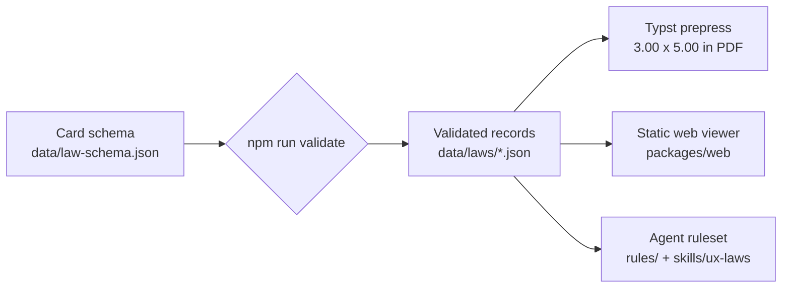

<div align="center">
    
    <h1>Knowledge Domain Decks</h1>
    <p><strong>One dataset. Print, phone, and agent output.</strong></p>
    <p><em>An open-source reference card deck for UX and behavioral design, where every card is a validated record and every artifact is generated from it.</em></p>
    <p>
        <a href="./LICENSE"></a>
        <a href="./LICENSE-DATA"></a>
        
        
    </p>
</div>

---

## 📖 Table of Contents

- [🤔 What is this?](#-what-is-this)
- [🃏 The First Deck](#-the-first-deck)
- [🎴 How to Use It](#-how-to-use-it)
- [🧩 Card Anatomy](#-card-anatomy)
- [🗂️ Repository Layout](#️-repository-layout)
- [🛠️ Developer Setup & Verification](#️-developer-setup--verification)
- [📄 Citation & License](#-citation--license)

---

## 🤔 What is this?

**Knowledge Domain Decks** turns a body of professional knowledge into reference
cards that a person can hold, a phone can show, and a coding agent can apply.
The first deck covers UX and behavioral design: six principles, each distilled
into the smallest usable form — an axiom, a trigger, a checklist, an
anti-pattern, a generated diagram, and one exact academic source.

The point is not the PDF, the web page, or the skill file. The point is that
all three come from the same validated records:



Every output is generated. Nothing is hand-edited downstream: fix a typo in a
card record, rerun the generators, and the PDF, the viewer bundle, and the rules
all move together. Regeneration is deterministic, so the same records always
produce the same bytes.

The deck is deliberately clean-room. The wording is written for this project,
the diagrams are drawn parametrically from each card's `graphicMetaphor` data,
and no other deck's copy, names, or trade dress is used.

---

## 🃏 The First Deck

**UX & Behavioral Design** is a six-card vertical slice that proves the whole
pipeline end to end. It is not the finished 52-card deck; it is a small deck
that is genuinely usable while the rest is written.

Each card cites one primary paper, with that paper's own authors, year, title,
and venue:

| ID | Card | Category | Primary source |
|---|---|---|---|
| HMM-01 | **Jakob's Law** | Heuristic & Mental Models | Nielsen (2000), *Designing Web Usability* |
| GES-01 | **Law of Proximity** | Gestalt & Visual Perception | Wertheimer (1923), *Untersuchungen zur Lehre von der Gestalt II* |
| DEC-01 | **Hick's Law** | Decision-Making & Cognitive Load | Hick (1952), *On the Rate of Gain of Information* |
| DEC-02 | **Miller's Law** | Decision-Making & Cognitive Load | Miller (1956), *The Magical Number Seven, Plus or Minus Two* |
| TME-01 | **Fitts's Law** | Time, Motion & Ergonomics | Fitts (1954), *The Information Capacity of the Human Motor System* |
| MPA-01 | **Serial Position Effect** | Memory, Perception & Attention | Murdock (1962), *The Serial Position Effect of Free Recall* |

The categories are part of the schema, so every later card lands in one of
them and the filters, accents, and rules sections follow automatically:

| Category | Cards | What it audits |
|---|---|---|
| Heuristic & Mental Models | HMM-01 | Whether the interface matches what people already know |
| Gestalt & Visual Perception | GES-01 | Grouping, spacing, and perceived structure |
| Decision-Making & Cognitive Load | DEC-01, DEC-02 | Option count, comparison effort, working memory |
| Time, Motion & Ergonomics | TME-01 | Target size, distance, and motor effort |
| Memory, Perception & Attention | MPA-01 | Position, sequence, and what survives recall |

---

## 🎴 How to Use It

### Web: open the file

Open [`packages/web/index.html`](./packages/web/index.html) in any modern
browser. Double-clicking the file works: a generated classic script carries the
card data, so nothing needs a server, a bundler, or a network connection.

- Tap or click a card, or press **Enter** / **Space**, to flip between the
  principle and its operational checklist.
- Filter by category with the pills above the deck.
- The layout is built for a 390 px phone viewport and has no horizontal scroll.

<div align="center">
    
</div>

### Print: build the PDF

The print layer is a Typst template that renders one card per page, recto and
verso, at Tarot proportions: a 3.00 x 5.00 in page holding a 2.75 x 4.75 in trim
plus 0.125 in bleed, with corner trim marks.

```bash
npm run build:pdf
```

The output is `packages/prepress/dist/ux-deck.pdf`. This step requires
[Typst](https://typst.app/) on `PATH`; the build script checks for it and exits
with an install message rather than substituting another renderer.

**What has been checked in the built PDF.** With Typst 0.15.1, `npm run
build:pdf` emits a 12-page file of about 169 KiB. `npm run check:pdf` measured a
216 x 360 pt MediaBox on every page. On the rendered pages, trim ticks sit in
the bleed band at the trim corners; every font is 6.5 pt or larger, with the
Source line read back at 6.5 pt on all six versos and absent from the rectos;
the worst text overrun past the safe box is 0.97 pt on page 7, with 8.03 pt of
paper still before the trim; and every image is a form XObject, so the diagram
is real vector geometry.

### Agents: load the ruleset

Two generated files carry the same deck into an agent's working context:

- [`skills/ux-laws/SKILL.md`](./skills/ux-laws/SKILL.md) — a skill with a
  trigger-oriented description, ready to drop into an agent's skills directory.
- [`rules/ux-rules.md`](./rules/ux-rules.md) — a plain ruleset for review
  prompts or project instructions.

Both are generated from `data/laws/*.json` by `npm run build:rules`. Edit the
records, not the generated files.

---

## 🧩 Card Anatomy

Every card is one JSON object with nine fields. The schema rejects unknown
fields, so a record cannot quietly grow a second source of truth:

| Field | What it holds |
|---|---|
| `id` | Category prefix and two-digit sequence, e.g. `DEC-01` |
| `name` | The principle's common name, 50 characters or fewer |
| `category` | One of the five fixed categories |
| `axiom` | The core claim, at most 15 words |
| `trigger` | The observable symptom that means "check this card" |
| `checklist` | Three or four concrete, testable actions |
| `antiPattern` | A `violation` and its `remediation`, as one pair |
| `graphicMetaphor` | An `svgShape` plus the parameters that draw it |
| `academicOrigin` | One primary source: authors, year, title, venue, optional DOI |

The validator enforces the limits the schema alone cannot: the axiom must be
both 110 characters or fewer and 15 words or fewer, because a character cap
does not bound a printed line and a word count does not bound glyph width.
Checklist items cap at 120 characters, IDs must match `^[A-Z]{3}-[0-9]{2}$`,
and duplicate IDs fail the run.

---

## 🗂️ Repository Layout

```
.
├── data/
│   ├── law-schema.json          # Canonical JSON Schema (draft 2020-12)
│   └── laws/*.json              # One validated record per card
├── packages/
│   ├── prepress/                # Typst template + PDF build script
│   │   ├── src/card.typ
│   │   └── build.mjs
│   ├── web/                     # Static viewer (open index.html)
│   │   ├── index.html
│   │   ├── styles.css
│   │   ├── app.js
│   │   └── deck-data.js         # Generated card bundle
│   └── rules/                   # Ruleset generator
├── rules/ux-rules.md            # Generated agent ruleset
├── skills/ux-laws/SKILL.md      # Generated agent skill
├── scripts/
│   ├── validate.mjs             # Schema + cross-record checks
│   ├── svg.js                   # Parametric SVG generator
│   ├── generate-web-data.mjs    # Builds packages/web/deck-data.js
│   ├── check-web.mjs            # Headless 390 px viewer smoke test
│   └── pdf-check.mjs            # Page-box and page-count check
├── media/
│   ├── icons/                   # Transparent WebP icon set (1024 master, web sizes)
│   └── card-viewer-390.png      # README screenshot
├── DECISIONS.md                 # Deviations from the source specs and why
├── CHANGELOG.md
├── LICENSE                      # MIT (code)
└── LICENSE-DATA                 # CC0-1.0 (data and schema)
```

---

## 🛠️ Developer Setup & Verification

### Requirements

- **Node.js 22+** — the scripts use the built-in `fetch` and `WebSocket`.
- **Chrome or Chromium** — only for `npm run check:web` (set `CHROME_PATH` if it
  is not in a standard location).
- **Typst** — only for `npm run build:pdf` and `npm run check:pdf`.

### Commands

```bash
# 1. Install the single dev dependency (Ajv)
npm install

# 2. Validate every record against the schema
npm run validate

# 3. Regenerate the derived artifacts
npm run build:web       # packages/web/deck-data.js
npm run build:rules     # rules/ux-rules.md and skills/ux-laws/SKILL.md

# 4. Print layer (requires Typst)
npm run build:pdf       # packages/prepress/dist/ux-deck.pdf
npm run check:pdf       # every MediaBox is 216 x 360 pt, page count matches

# 5. Checks
npm run check:web       # headless 390 px smoke test (Chrome/Chromium)
npm run check:all       # validate + regenerate rules and web data + web smoke test
npm run check           # validate + regenerate, without the browser step
```

### What the checks prove

| Command | Proves |
|---|---|
| `npm run validate` | Every record satisfies the schema, axiom length and word limits hold, IDs are unique |
| `npm run build:web` | The viewer bundle regenerates from `data/laws/` |
| `npm run build:rules` | The ruleset and skill regenerate from the same records |
| `npm run check:web` | At 390 px: no horizontal overflow, six cards render, flip exposes the verso, a filter narrows to one |
| `npm run check:pdf` | Every page's MediaBox is 216 x 360 pt and the page count is twice the card count |

Last full run: **2026-11-09**, macOS, Node 22.23.4, Chrome 157, Typst 0.15.1 —
`npm run check:all` exits 0 and the PDF builds.

One honest limit: `npm run check:pdf` proves page geometry only. Whether the
marks land on paper and whether the type reads comfortably at print size are
judgements from looking at rendered pages, not something the check asserts.

---

## 📄 Citation & License

If you reference Knowledge Domain Decks in research, teaching, or software,
please cite:

```bibtex
@software{Mustard_Knowledge_Domain_Decks_2026,
  author = {Mustard, Thomas J. L.},
  title = {{Knowledge Domain Decks}},
  year = {2026},
  url = {https://github.com/tjmustard/knowledge-domain-decks-skills}
}
```

Code is distributed under the **MIT License**; see [`LICENSE`](./LICENSE).
Card data and the JSON Schema are dedicated to the public domain under
**CC0-1.0**; see [`LICENSE-DATA`](./LICENSE-DATA).

The research notes under `SupportingInformation/` are read-only inputs whose
provenance and licensing are separate from this repository. They are excluded
from git; the knowledge they carry reaches the deck through the CC0 dataset and
the citations printed on each card.
